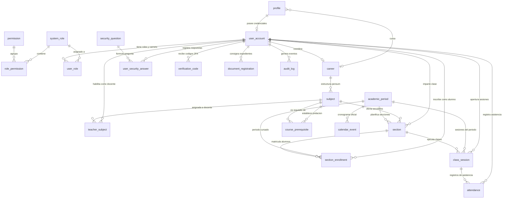
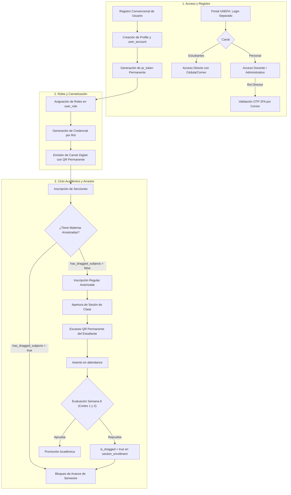

# Documentación de la Base de Datos — UNEFA Asistencias & Carnets

> [!NOTE]
<<<<<<< Updated upstream
> Esta documentación fue hecha a partir de las 5 migraciones Laravel ubicadas en `database/migrations/` y los seeders en `database/seeders/`. Fecha: **22 de noviembre de 2026**. Esta no es la versión definitiva y puede ser modificada en un futuro si surgen cambios en la estructura de la base de datos.
=======
> **Estado de la Documentación:** Actualizada y verificada al **22 de noviembre de 2026** sobre la rama `develop`.
> Esta versión integra la estructura de 22 tablas definida en las migraciones Laravel (`database/migrations/`), el volcado DDL (`database/schema.sql`) y los datos semilla (`database/seeders/`), consolidando formalmente las **Directrices de Diseño del 21/11/2026**.

---

## Directrices de Diseño y Reglas de Negocio (21/11/2026)

El modelo de datos y la arquitectura operativa del sistema incorporan cinco directrices obligatorias emitidas el 21 de noviembre de 2026:

### 1. Código QR Único y Permanente
- **Principio:** Se descarta el uso de tablas separadas para códigos QR temporales o efímeros para el pase de asistencia.
- **Implementación:** Cada persona física posee un identificador inmutable y permanente almacenado en `user_account.qr_token` (`VARCHAR(128) UNIQUE`).
- **Alcance:** Este token acompaña al alumno o docente durante toda su trayectoria universitaria y se codifica tanto en el carnet físico/digital como en el módulo de escaneo de asistencia en el aula.

### 2. Múltiples Roles y Carnetización Independiente
- **Principio:** Una persona física puede ostentar simultáneamente múltiples roles activos dentro de la institución (por ejemplo, un usuario puede ser estudiante de pregrado y docente/preparador al mismo tiempo).
- **Implementación:** La tabla asociativa `user_role` vincula `user_account` con `system_role` y almacena para cada asignación individual su propio número de carnet (`credential_number VARCHAR(50) UNIQUE`), fecha de expedición (`credential_issued_at`) y fecha de vencimiento (`credential_expires_at`).
- **Consecuencia:** Cada rol activo genera una credencial física/digital con su propio número de folio y vigencia, manteniendo los permisos segregados según el perfil que se encuentre ejerciendo.

### 3. Control de Materias Arrastradas y Bloqueo de Avance
- **Principio:** Si un estudiante reprueba o arrastra una materia, el sistema restringe su avance al siguiente semestre académico hasta que apruebe y subsane la asignatura pendiente.
- **Implementación:**
  - `profile.current_semester`: Semestre nominal cursado.
  - `profile.has_dragged_subjects`: Bandera booleana de consulta rápida que indica si el estudiante adeuda materias.
  - `section_enrollment.is_dragged`: Marca asignaturas en condición de repitencia.
  - `section_enrollment.status`: Estados de inscripción (`Pending`, `Enrolled`, `Approved`, `Failed`, `Withdrawn`, `Rejected`).
  - `course_prerequisite`: Matriz relacional de prelaciones entre materias.
- **Regla Operativa:** Un estudiante con `has_dragged_subjects = true` o asignaturas en estado `Failed` no puede ser promovido ni inscribir carga académica perteneciente a semestres superiores (`current_semester + 1`) que colisionen o dependan de la aprobación previa de las asignaturas rezagadas.

### 4. Ajustes de Interfaz y Arquitectura de Acceso
- **Nomenclatura Institucional:** Se sustituyó formalmente el acrónimo anterior **"SICEU"** por la denominación oficial **"Portal"** (Portal Institucional / Portal Académico UNEFA) en vistas, rutas y documentación.
- **Bifurcación del Terminal de Acceso:** La pantalla de inicio de sesión separa el acceso en dos pestañas funcionales:
  - **Canal Estudiantes:** Autenticación rápida por Cédula/Correo y Contraseña.
  - **Canal Personal (Docentes y Administrativos):** Autenticación con soporte para validaciones avanzadas (2FA de 6 dígitos para directores y clave secundaria institucional).
- **Registro Convencional:** Se eliminó el flujo antiguo de preinscripción CINU; el registro en el portal opera como una apertura de cuenta formal universitaria vinculada al expediente del titular.

### 5. Cronograma y Hitos de Evaluación del Proyecto
- **Confirmación Académica:** La evaluación conjunta del **1er y 2do corte** quedó formalmente fijada para la **Semana 8** del período lectivo (iniciando la semana 7 el 22/11/2026).
- **Soporte en Base de Datos:** Las tablas `academic_period`, `calendar_event` y `class_session` registran la duración estándar (16 semanas), el cómputo de semanas de clase (`week_number`) y los hitos del cronograma académico.

---

## Matriz de Trazabilidad: Directrices vs Base de Datos

| Directriz | Tablas Involucradas | Columnas Clave | Índices / Restricciones | Regla / Comportamiento |
| :--- | :--- | :--- | :--- | :--- |
| **QR Único y Permanente** | `user_account` | `qr_token` (VARCHAR 128) | `uniq_user_qr_token` (UNIQUE) | Asignado al crear la cuenta. Token fijo de por vida para el carnet y lector QR. No requiere tablas temporales. |
| **Múltiples Roles y Carnets** | `user_role`, `system_role`, `role_permission` | `user_role.credential_number`, `credential_issued_at`, `credential_expires_at`, `is_active` | `uniq_credential_number` (UNIQUE), `uniq_user_role` (UNIQUE compuesto) | Cada rol asignado a un usuario genera un registro con su propio número de carnet y vigencia. |
| **Control de Arrastre de Materias** | `profile`, `section_enrollment`, `course_prerequisite`, `subject` | `profile.has_dragged_subjects`, `profile.current_semester`, `section_enrollment.is_dragged`, `section_enrollment.status` | `idx_profile_semester` (`current_semester`, `has_dragged_subjects`), `idx_enrollment_dragged` (`student_id`, `status`, `is_dragged`) | Bloquea el incremento de semestre y la inscripción en semestres posteriores mientras existan materias reprobadas. |
| **Ajustes de Interfaz y Acceso** | `user_account`, `verification_code`, `document_registration` | `verification_code.code_type`, `user_account.security_pin_hash`, `document_registration.status` | `idx_vc_lookup`, `idx_doc_user_status` | Soporta canal Estudiante vs Personal, validación 2FA por correo para directores y registro de cuenta regular. |
| **Hito Evaluativo Semana 8** | `academic_period`, `calendar_event`, `class_session`, `section_enrollment` | `academic_period.duration_weeks`, `calendar_event.start_date`, `class_session.week_number`, `section_enrollment.final_grade` | `idx_event_period_dates`, `idx_session_section_status` | Planificación de períodos a 16 semanas con registro semanal de sesiones y cierre de ciclo evaluativo de cortes 1 y 2 en semana 8. |
>>>>>>> Stashed changes

---

## Diagrama Entidad-Relación



---

## Estructura Modular del Sistema (22 Tablas)

La base de datos está normalizada en **Tercera Forma Normal (3FN)** y distribuida en **5 módulos temáticos**, coincidiendo exactamente con los archivos de migración de Laravel:

| # | Módulo Funcional | Tablas | Archivo de Migración |
|---|---|:---:|---|
| 1 | Seguridad, Roles y Autenticación | 10 | `2026_11_20_000001_create_security_and_auth_tables.php` |
| 2 | Académico, Pensum y Calendario | 5 | `2026_11_20_000002_create_academic_tables.php` |
| 3 | Secciones, Docentes e Inscripciones | 3 | `2026_11_20_000003_create_enrollment_and_section_tables.php` |
| 4 | Sesiones y Control de Asistencias | 2 | `2026_11_20_000004_create_attendance_tables.php` |
| 5 | Auditoría y Seguridad Perimetral | 2 | `2026_11_20_000005_create_audit_tables.php` |

---

## Módulo 1 — Seguridad, Roles y Autenticación

### `system_role`
Catálogo maestro de roles del sistema con asignación de nivel jerárquico numérico para control de acceso basado en roles (RBAC).

| Columna | Tipo de Dato | Restricciones | Descripción |
|---|---|---|---|
| `id` | INT UNSIGNED | PK, Auto-increment | Identificador único del rol |
| `role_name` | VARCHAR(50) | UNIQUE | Nombre identificador (ej: `Super Administrator`, `Director`, `Academic Coordinator`, `Teacher`, `Student`) |
| `hierarchy_level` | TINYINT UNSIGNED | INDEX | Nivel de precedencia jerárquica (1 = Máximo privilegio) |
| `description` | VARCHAR(255) | NOT NULL | Resumen del alcance y funciones asignadas al rol |

- **Índices:** `uniq_role_name` (UNIQUE), `idx_role_hierarchy` (INDEX).

---

### `permission`
Catálogo de capacidades atómicas del sistema, agrupadas por módulo operativo.

| Columna | Tipo de Dato | Restricciones | Descripción |
|---|---|---|---|
| `id` | INT UNSIGNED | PK, Auto-increment | Identificador único del permiso |
| `permission_key` | VARCHAR(80) | UNIQUE | Clave técnica en formato `modulo.accion` (ej: `attendance.scan`, `credential.issue`) |
| `permission_name` | VARCHAR(100) | NOT NULL | Título legible de la acción |
| `module` | VARCHAR(50) | INDEX | Dominio al que pertenece (`Seguridad`, `Direccion`, `Coordinacion`, `Docencia`, `General`, `Estudiantes`) |
| `description` | VARCHAR(255) | NULLABLE | Descripción complementaria del privilegio |

- **Índices:** `uniq_permission_key` (UNIQUE), `idx_permission_module` (INDEX).

---

### `role_permission`
Tabla asociativa intermedia (N:M) que vincula permisos con roles jerárquicos.

| Columna | Tipo de Dato | Restricciones | Descripción |
|---|---|---|---|
| `id` | INT UNSIGNED | PK, Auto-increment | Identificador único de la asignación |
| `role_id` | INT UNSIGNED | FK → `system_role.id` ON DELETE CASCADE | Rol al que se concede el permiso |
| `permission_id` | INT UNSIGNED | FK → `permission.id` ON DELETE CASCADE, INDEX | Permiso concedido |

- **Índices:** `uniq_role_permission` (UNIQUE compuesto `[role_id, permission_id]`), `idx_rp_permission` (INDEX).

---

### `profile`
Entidad que resguarda los datos personales y civiles del individuo. Se mantiene desacoplada de `user_account` para permitir que existan perfiles académicos pre-cargados antes de formalizar la activación de usuario.

| Columna | Tipo de Dato | Restricciones | Descripción |
|---|---|---|---|
| `id` | INT UNSIGNED | PK, Auto-increment | Identificador único del perfil |
| `career_id` | INT UNSIGNED | FK → `career.id` ON DELETE SET NULL, NULLABLE, INDEX | Carrera o programa académico al que está adscrito |
| `id_number` | VARCHAR(20) | UNIQUE | Número de Cédula de Identidad |
| `id_type` | VARCHAR(2) | DEFAULT 'V' | Prefijo de nacionalidad (`V` = Venezolano, `E` = Extranjero) |
| `first_name` | VARCHAR(50) | NOT NULL | Primer nombre oficial |
| `middle_name` | VARCHAR(50) | NULLABLE | Segundo nombre oficial |
| `last_name` | VARCHAR(50) | NOT NULL | Primer apellido oficial |
| `second_last_name` | VARCHAR(50) | NULLABLE | Segundo apellido oficial |
| `current_semester` | TINYINT UNSIGNED | DEFAULT 1 | Semestre en curso del estudiante |
| `has_dragged_subjects` | BOOLEAN | DEFAULT false | Bandera rápida de materias reprobadas o arrastradas |
| `address` | VARCHAR(255) | NULLABLE | Dirección física de residencia |
| `phone` | VARCHAR(20) | NULLABLE | Número telefónico de contacto |
| `job_title` | VARCHAR(100) | NULLABLE | Cargo laboral (para personal docente y administrativo) |
| `profile_picture` | VARCHAR(255) | NULLABLE | Nombre de archivo o ruta de la fotografía institucional |
| `created_at` | TIMESTAMP | DEFAULT CURRENT_TIMESTAMP | Fecha de alta del perfil |
| `updated_at` | TIMESTAMP | DEFAULT CURRENT_TIMESTAMP ON UPDATE CURRENT_TIMESTAMP | Fecha de última modificación |

- **Índices:** `uniq_id_number` (UNIQUE), `idx_profile_career` (INDEX), `idx_profile_semester` (INDEX compuesto `[current_semester, has_dragged_subjects]`).

> [!WARNING]
> **Regla de Avance Académico:** El índice compuesto `idx_profile_semester` permite al motor del Portal consultar de forma instantánea si un estudiante puede o no ser promovido de semestre. Si `has_dragged_subjects = true`, el sistema bloquea cualquier avance curricular.

---

### `user_account`
Credenciales y parámetros de autenticación del usuario. Relación unívoca (1:1) estricta con `profile`.

| Columna | Tipo de Dato | Restricciones | Descripción |
|---|---|---|---|
| `id` | INT UNSIGNED | PK, Auto-increment | Identificador único de la cuenta |
| `profile_id` | INT UNSIGNED | FK → `profile.id` ON DELETE CASCADE, UNIQUE | Vínculo directo 1:1 con los datos personales |
| `username` | VARCHAR(100) | UNIQUE | Identificador alfanumérico para inicio de sesión |
| `email` | VARCHAR(100) | UNIQUE | Correo institucional o personal verificado |
| `password_hash` | VARCHAR(255) | NOT NULL | Hash seguro de la contraseña principal (Bcrypt / Argon2) |
| `qr_token` | VARCHAR(128) | UNIQUE | Identificador alfanumérico permanente y único por persona |
| `security_pin_hash` | VARCHAR(255) | NULLABLE | Hash del PIN secundario de autorización (Director) |
| `pin_expires_at` | DATETIME | NULLABLE, INDEX | Fecha de caducidad del PIN de autorización |
| `pin_updated_at` | DATETIME | NULLABLE | Marca temporal del último cambio de PIN |
| `status` | ENUM | DEFAULT 'Pending', INDEX | Estado operativo: `Pending`, `Approved`, `Rejected`, `Inactive` |
| `created_at` | TIMESTAMP | DEFAULT CURRENT_TIMESTAMP | Fecha de creación de la cuenta |
| `updated_at` | TIMESTAMP | DEFAULT CURRENT_TIMESTAMP ON UPDATE CURRENT_TIMESTAMP | Fecha de última actualización |

- **Índices:** `uniq_profile_id` (UNIQUE), `uniq_username` (UNIQUE), `uniq_email` (UNIQUE), `uniq_user_qr_token` (UNIQUE), `idx_user_pin_expiration` (INDEX), `idx_user_status` (INDEX).

<<<<<<< Updated upstream
**Guía de funcionamiento:**
El campo `qr_token` es un identificador **único y permanente** por persona. Se usa para generar el código QR del carnet y registrar asistencias mediante escaneo. Este token se genera una sola vez al crear la cuenta y no cambia, garantizando que el QR del carnet sea válido durante toda la vida del usuario en el sistema.
=======
> [!IMPORTANT]
> **QR Permanente e Inmutable:** El campo `qr_token` es el único identificador empleado para generar el código QR institucional. Al estar fijado en la cuenta de usuario, erradica la dependencia de tokens rotativos efímeros y tablas temporales adicionales.
>>>>>>> Stashed changes

---

### `user_role`
Asignación de roles al usuario. Permite **polimorfismo de roles y emisión de credenciales independientes**.

| Columna | Tipo de Dato | Restricciones | Descripción |
|---|---|---|---|
| `id` | INT UNSIGNED | PK, Auto-increment | Identificador único del registro de rol |
| `user_id` | INT UNSIGNED | FK → `user_account.id` ON DELETE CASCADE | Cuenta de usuario beneficiaria |
| `role_id` | INT UNSIGNED | FK → `system_role.id` ON DELETE RESTRICT | Rol otorgado |
| `is_active` | BOOLEAN | DEFAULT true | Estado de habilitación del rol |
| `credential_number` | VARCHAR(50) | NULLABLE, UNIQUE | Folio / Serial del carnet correspondiente a este rol |
| `credential_issued_at` | DATETIME | NULLABLE | Fecha de emisión de la credencial para este rol |
| `credential_expires_at` | DATETIME | NULLABLE | Fecha de expiración de la credencial para este rol |
| `assigned_at` | TIMESTAMP | DEFAULT CURRENT_TIMESTAMP | Fecha de asignación del rol |

- **Índices:** `uniq_user_role` (UNIQUE compuesto `[user_id, role_id]`), `uniq_credential_number` (UNIQUE), `idx_ur_role_active` (INDEX compuesto `[role_id, is_active]`).

<<<<<<< Updated upstream
**Guía de funcionamiento:**
Un usuario puede tener múltiples roles simultáneos (ej: Estudiante + Preparador). Cada combinación `user_id` + `role_id` es única, y cada rol genera su propio carnet con número de credencial independiente. El borrado de un `system_role` está **restringido** (`RESTRICT`) para evitar eliminar roles que estén en uso; primero se deben reasignar o eliminar las asignaciones existentes.
=======
> [!TIP]
> **Carnets Múltiples por Persona:** Un usuario con dos roles activos (ej. Estudiante y Docente) dispone de dos registros en `user_role`, cada uno con su propio `credential_number`, plantilla visual asociada y fechas de vigencia distintas, garantizando trazabilidad institucional completa.
>>>>>>> Stashed changes

---

### `security_question`
Catálogo institucional de preguntas predefinidas para la recuperación de accesos.

| Columna | Tipo de Dato | Restricciones | Descripción |
|---|---|---|---|
| `id` | INT UNSIGNED | PK, Auto-increment | Identificador único de la pregunta |
| `question_text` | VARCHAR(255) | NOT NULL | Enunciado de la interrogante de seguridad |

---

### `user_security_answer`
Respuestas almacenadas de forma unidireccional (hash) provistas por el usuario.

| Columna | Tipo de Dato | Restricciones | Descripción |
|---|---|---|---|
| `id` | INT UNSIGNED | PK, Auto-increment | Identificador único del registro |
| `user_id` | INT UNSIGNED | FK → `user_account.id` ON DELETE CASCADE | Usuario titular |
| `question_id` | INT UNSIGNED | FK → `security_question.id` ON DELETE CASCADE, INDEX | Pregunta contestada |
| `answer_hash` | VARCHAR(255) | NOT NULL | Hash Bcrypt de la respuesta normalizada (validada entre 4 y 16 caracteres) |

- **Índices:** `uniq_user_question` (UNIQUE compuesto `[user_id, question_id]`), `idx_answer_question` (INDEX).

---

### `verification_code`
Mecanismo centralizado para despacho de códigos de un solo uso (OTP) por correo electrónico (2FA de Directores, reseteo de claves y validación de PIN).

| Columna | Tipo de Dato | Restricciones | Descripción |
|---|---|---|---|
| `id` | INT UNSIGNED | PK, Auto-increment | Identificador único del código OTP |
| `user_id` | INT UNSIGNED | FK → `user_account.id` ON DELETE CASCADE | Destinatario del código |
| `code` | VARCHAR(10) | INDEX | Código aleatorio generado (numérico de 6 dígitos) |
| `code_type` | ENUM | DEFAULT 'Password_Reset' | Propósito: `2FA_Login`, `Password_Reset`, `Security_Questions_Reset`, `Pin_Reset` |
| `expires_at` | DATETIME | NOT NULL | Marca límite de vigencia del código (típicamente 10 minutos) |
| `is_used` | BOOLEAN | DEFAULT false | Bandera de consumo del código |
| `created_at` | TIMESTAMP | DEFAULT CURRENT_TIMESTAMP | Fecha y hora de generación |

- **Índices:** `idx_vc_code` (INDEX), `idx_vc_lookup` (INDEX compuesto `[user_id, code_type, is_used, expires_at]`).

---

### `document_registration`
Repositorio documental de expedientes digitales presentados por estudiantes y aspirantes durante el proceso de matriculación.

| Columna | Tipo de Dato | Restricciones | Descripción |
|---|---|---|---|
| `id` | INT UNSIGNED | PK, Auto-increment | Identificador único del recaudo |
| `user_id` | INT UNSIGNED | FK → `user_account.id` ON DELETE CASCADE | Usuario que consigna el documento |
| `file_name` | VARCHAR(255) | NOT NULL | Nombre físico o denominación del archivo |
| `file_path` | VARCHAR(255) | NOT NULL | Ruta interna en el sistema de almacenamiento (`storage/app/`) |
| `file_type` | ENUM | DEFAULT 'PDF' | Formato de archivo: `Word`, `PDF`, `Image`, `Excel` |
| `status` | ENUM | DEFAULT 'Pending', INDEX | Estado de revisión: `Pending`, `Approved`, `Rejected` |
| `observations` | VARCHAR(500) | NULLABLE | Motivos de rechazo o notas aclaratorias de Control de Estudios |
| `uploaded_at` | TIMESTAMP | DEFAULT CURRENT_TIMESTAMP | Fecha de carga del expediente |

- **Índices:** `idx_doc_status` (INDEX), `idx_doc_user_status` (INDEX compuesto `[user_id, status]`).

---

## Módulo 2 — Académico, Pensum y Calendario

### `career`
Programas de formación académica ofertados en la sede o núcleo universitario.

| Columna | Tipo de Dato | Restricciones | Descripción |
|---|---|---|---|
| `id` | INT UNSIGNED | PK, Auto-increment | Identificador único de la carrera |
| `career_code` | VARCHAR(20) | UNIQUE | Código de carrera oficial (ej: `SYS-ING`) |
| `career_name` | VARCHAR(100) | NOT NULL | Nombre oficial (ej: `Ingeniería de Sistemas`) |
| `coordinator_id` | INT UNSIGNED | FK → `user_account.id` ON DELETE SET NULL, NULLABLE, INDEX | Usuario con rol de Coordinador asignado a la dirección del pensum |

- **Índices:** `uniq_career_code` (UNIQUE), `idx_career_coordinator` (INDEX).

---

### `subject`
Malla curricular de asignaturas distribuidas por semestre y carrera.

| Columna | Tipo de Dato | Restricciones | Descripción |
|---|---|---|---|
| `id` | INT UNSIGNED | PK, Auto-increment | Identificador único de la materia |
| `career_id` | INT UNSIGNED | FK → `career.id` ON DELETE SET NULL, NULLABLE, DEFAULT 1 | Carrera a la que corresponde la asignatura |
| `subject_code` | VARCHAR(20) | UNIQUE | Código de cátedra unificado |
| `subject_name` | VARCHAR(100) | NOT NULL | Nombre de la asignatura |
| `semester` | TINYINT UNSIGNED | NULLABLE, INDEX | Semestre académico de ubicación natural (1 al 10) |
| `credit_units` | TINYINT UNSIGNED | DEFAULT 3 | Carga valorativa en unidades de crédito |
| `display_order` | TINYINT UNSIGNED | DEFAULT 1 | Orden secuencial de renderizado en el pensum |

- **Índices:** `uniq_subject_code` (UNIQUE), `idx_subject_semester` (INDEX), `idx_subject_career_semester` (INDEX compuesto `[career_id, semester]`).

---

### `course_prerequisite`
Matriz relacional recursiva (N:M) de prelaciones y requisitos académicos entre asignaturas.

| Columna | Tipo de Dato | Restricciones | Descripción |
|---|---|---|---|
| `id` | INT UNSIGNED | PK, Auto-increment | Identificador único de la prelación |
| `subject_id` | INT UNSIGNED | FK → `subject.id` ON DELETE CASCADE | Materia dependiente que exige el requisito |
| `prerequisite_id` | INT UNSIGNED | FK → `subject.id` ON DELETE CASCADE, INDEX | Materia prerrequisito indispensable |

- **Índices:** `uniq_subject_prereq` (UNIQUE compuesto `[subject_id, prerequisite_id]`), `idx_prereq_required` (INDEX).

---

### `academic_period`
Ciclos y términos lectivos de la institución (semestres regulares o intensivos).

| Columna | Tipo de Dato | Restricciones | Descripción |
|---|---|---|---|
| `id` | INT UNSIGNED | PK, Auto-increment | Identificador único del período |
| `period_name` | VARCHAR(50) | UNIQUE | Nombre formal del período (ej: `2026-1`) |
| `start_date` | DATE | NOT NULL | Fecha oficial de inicio de actividades |
| `end_date` | DATE | NULLABLE | Fecha proyectada o real de cierre del ciclo |
| `duration_weeks` | TINYINT UNSIGNED | DEFAULT 16 | Extensión estándar en semanas lectivas |
| `status` | ENUM | DEFAULT 'Active', INDEX | Estado del período: `Active`, `Closed`, `Planned` |
| `created_at` | TIMESTAMP | DEFAULT CURRENT_TIMESTAMP | Fecha de alta del período |

- **Índices:** `uniq_period_name` (UNIQUE), `idx_period_status` (INDEX).

---

### `calendar_event`
Cronograma detallado de hitos, jornadas y evaluaciones programadas por período académico.

| Columna | Tipo de Dato | Restricciones | Descripción |
|---|---|---|---|
| `id` | INT UNSIGNED | PK, Auto-increment | Identificador único del evento |
| `period_id` | INT UNSIGNED | FK → `academic_period.id` ON DELETE CASCADE | Período al que se circunscribe |
| `year` | SMALLINT UNSIGNED | NOT NULL | Año del evento |
| `category` | VARCHAR(50) | NOT NULL | Tipo de hito (ej: `Inscripción`, `Evaluación`, `Feriado`, `Corte de Notas`) |
| `description` | VARCHAR(300) | NOT NULL | Detalle del hito (ej: `Evaluación Sumativa 1er y 2do Corte`) |
| `start_date` | DATE | NOT NULL | Fecha de inicio |
| `end_date` | DATE | NOT NULL | Fecha de finalización |
| `created_at` | TIMESTAMP | DEFAULT CURRENT_TIMESTAMP | Fecha de registro en el cronograma |

- **Índices:** `idx_event_period_dates` (INDEX compuesto `[period_id, start_date, end_date]`).

---

## Módulo 3 — Secciones, Docentes e Inscripciones

### `teacher_subject`
Habilitación y asignación de docentes titulares por cátedra.

| Columna | Tipo de Dato | Restricciones | Descripción |
|---|---|---|---|
| `id` | INT UNSIGNED | PK, Auto-increment | Identificador único de la habilitación |
| `teacher_id` | INT UNSIGNED | FK → `user_account.id` ON DELETE CASCADE | Usuario con rol Docente habilitado |
| `subject_id` | INT UNSIGNED | FK → `subject.id` ON DELETE CASCADE, INDEX | Asignatura autorizada |
| `assigned_by_id` | INT UNSIGNED | FK → `user_account.id` ON DELETE SET NULL, NULLABLE, INDEX | Coordinador o Director que autorizó la asignación |
| `created_at` | TIMESTAMP | DEFAULT CURRENT_TIMESTAMP | Fecha de asignación de carga |

- **Índices:** `uniq_teacher_subject` (UNIQUE compuesto `[teacher_id, subject_id]`), `idx_ts_subject` (INDEX), `idx_ts_assigned_by` (INDEX).

---

### `section`
Grupos y secciones operativas de clase con asignación de horario, aula y margen de tolerancia.

| Columna | Tipo de Dato | Restricciones | Descripción |
|---|---|---|---|
| `id` | INT UNSIGNED | PK, Auto-increment | Identificador único de la sección |
| `subject_id` | INT UNSIGNED | FK → `subject.id` ON DELETE CASCADE, INDEX | Asignatura dictada |
| `teacher_id` | INT UNSIGNED | FK → `user_account.id` ON DELETE CASCADE, INDEX | Docente responsable |
| `period_id` | INT UNSIGNED | FK → `academic_period.id` ON DELETE CASCADE | Período académico en curso |
| `section_name` | VARCHAR(30) | NOT NULL | Denominación de la sección (ej: `01-D`, `02-N`) |
| `day_of_week` | ENUM | DEFAULT 'Monday' | Día de clase: `Monday`, `Tuesday`, `Wednesday`, `Thursday`, `Friday`, `Saturday`, `Sunday` |
| `start_time` | TIME | DEFAULT '08:00:00' | Hora de inicio estipulada |
| `end_time` | TIME | DEFAULT '10:00:00' | Hora de culminación estipulada |
| `tolerance_minutes` | TINYINT UNSIGNED | DEFAULT 15 | Margen en minutos para registrar asistencia sin retardo |
| `classroom` | VARCHAR(50) | DEFAULT 'Aula 01' | Identificador del espacio físico o laboratorio |
| `status` | ENUM | DEFAULT 'Active' | Estado operativo: `Active`, `Inactive` |

- **Índices:** `idx_section_subject` (INDEX), `idx_section_teacher` (INDEX), `idx_section_period_status` (INDEX compuesto `[period_id, status]`), `idx_section_schedule` (INDEX compuesto `[day_of_week, start_time]`).

---

### `section_enrollment`
Matrícula e inscripción individual de estudiantes en secciones con registro de calificaciones y control estricto de materias arrastradas.

| Columna | Tipo de Dato | Restricciones | Descripción |
|---|---|---|---|
| `id` | INT UNSIGNED | PK, Auto-increment | Identificador único de la inscripción |
| `student_id` | INT UNSIGNED | FK → `user_account.id` ON DELETE CASCADE | Estudiante matriculado |
| `section_id` | INT UNSIGNED | FK → `section.id` ON DELETE CASCADE, INDEX | Sección inscrita |
| `period_id` | INT UNSIGNED | FK → `academic_period.id` ON DELETE CASCADE, INDEX | Período académico en curso |
| `status` | ENUM | DEFAULT 'Pending', INDEX | Condición académica: `Pending`, `Enrolled`, `Approved`, `Failed`, `Withdrawn`, `Rejected` |
| `is_dragged` | BOOLEAN | DEFAULT false | Bandera de materia cursada en condición de arrastre/repitencia |
| `final_grade` | TINYINT UNSIGNED | DEFAULT 0 | Calificación definitiva obtenida en escala 0-20 |
| `validated_by_coordinator` | BOOLEAN | DEFAULT false | Certificación de validez emitida por Control de Estudios |
| `is_cycle_closed` | BOOLEAN | DEFAULT false | Cierre de actas y consolidación de notas definitivas |
| `assigned_at` | TIMESTAMP | DEFAULT CURRENT_TIMESTAMP | Fecha de matriculación |
| `updated_at` | TIMESTAMP | DEFAULT CURRENT_TIMESTAMP ON UPDATE CURRENT_TIMESTAMP | Fecha de modificación o asentamiento de nota |

- **Índices:** `uniq_student_section` (UNIQUE compuesto `[student_id, section_id]`), `idx_enrollment_section` (INDEX), `idx_enrollment_period` (INDEX), `idx_enrollment_status` (INDEX), `idx_enrollment_dragged` (INDEX compuesto `[student_id, status, is_dragged]`).

<<<<<<< Updated upstream
**Guía de funcionamiento:**
El campo `is_dragged` indica que la inscripción corresponde a una materia que el estudiante ya cursó previamente y reprobó. Este campo funciona en conjunto con `profile.has_dragged_subjects` (ver sección de problemas detectados). El ciclo de vida de una inscripción pasa por los estados: `Pending` → `Enrolled` (confirmada por el coordinador) → `Approved` / `Failed` (al cerrar el ciclo de evaluación). Los estados `Withdrawn` y `Rejected` representan salidas anticipadas del flujo normal.
=======
> [!WARNING]
> **Efecto de Materia Reprobada:** Cuando `status = 'Failed'`, la lógica de negocio activa automáticamente `is_dragged = true` y propaga `has_dragged_subjects = true` al perfil (`profile`) del alumno, impidiendo la inscripción de materias de semestres más avanzados hasta su aprobación.
>>>>>>> Stashed changes

---

## Módulo 4 — Sesiones y Control de Asistencias

### `class_session`
Apertura, control y cierre formal de cada jornada o bloque de clase presencial.

| Columna | Tipo de Dato | Restricciones | Descripción |
|---|---|---|---|
| `id` | INT UNSIGNED | PK, Auto-increment | Identificador único de la sesión |
| `section_id` | INT UNSIGNED | FK → `section.id` ON DELETE CASCADE | Sección asociada |
| `period_id` | INT UNSIGNED | FK → `academic_period.id` ON DELETE CASCADE, INDEX | Período académico activo |
| `opened_by_id` | INT UNSIGNED | FK → `user_account.id` ON DELETE CASCADE, INDEX | Docente que formaliza la apertura de la sesión |
| `session_date` | DATE | INDEX | Fecha calendario en que se imparte |
| `start_time` | TIME | NULLABLE | Hora exacta de inicio registrada por el docente |
| `end_time` | TIME | NULLABLE | Hora de culminación y cierre de la toma de lista |
| `tolerance_minutes` | TINYINT UNSIGNED | DEFAULT 15 | Tolerancia de puntualidad aplicada en minutos |
| `session_type` | ENUM | DEFAULT 'Regular' | Naturaleza de la clase: `Regular`, `Extraordinary` |
| `week_number` | TINYINT UNSIGNED | NULLABLE | Número de semana lectiva (1 a 16) |
| `status` | ENUM | DEFAULT 'Open' | Estado de la sesión: `Open`, `Closed` |
| `observations` | VARCHAR(255) | NULLABLE | Notas pedagógicas u ocurrencias registradas por el profesor |
| `created_at` | TIMESTAMP | DEFAULT CURRENT_TIMESTAMP | Marca de tiempo de apertura |

- **Índices:** `idx_session_period` (INDEX), `idx_session_opener` (INDEX), `idx_session_date` (INDEX), `idx_session_section_status` (INDEX compuesto `[section_id, status, session_date]`).

---

### `attendance`
Registro individualizado del pase de lista por estudiante en cada sesión de clase.

| Columna | Tipo de Dato | Restricciones | Descripción |
|---|---|---|---|
| `id` | INT UNSIGNED | PK, Auto-increment | Identificador único del registro de asistencia |
| `session_id` | INT UNSIGNED | FK → `class_session.id` ON DELETE CASCADE | Sesión de clase a la que asiste |
| `student_id` | INT UNSIGNED | FK → `user_account.id` ON DELETE CASCADE | Estudiante registrado |
| `registered_by_id` | INT UNSIGNED | FK → `user_account.id` ON DELETE SET NULL, NULLABLE, INDEX | Docente o usuario que formaliza la captura |
| `attendance_status` | ENUM | DEFAULT 'Present' | Estado de presencia: `Present`, `Absent`, `Excused`, `Late` |
| `registration_method` | ENUM | DEFAULT 'QR', INDEX | Vía de captura: `QR` (escaneo directo de carnet), `Manual` |
| `observation` | VARCHAR(255) | NULLABLE | Justificación médica o nota aclaratoria del retardo |
| `recorded_at` | TIMESTAMP | DEFAULT CURRENT_TIMESTAMP | Marca de tiempo exacta del escaneo o marcado |

- **Índices:** `uniq_session_student` (UNIQUE compuesto `[session_id, student_id]`), `idx_attendance_student_status` (INDEX compuesto `[student_id, attendance_status]`), `idx_attendance_registrar` (INDEX), `idx_attendance_method` (INDEX).

<<<<<<< Updated upstream
**Guía de funcionamiento:**
La asistencia se registra principalmente por **escaneo del código QR** del carnet (`registration_method = 'QR'`), usando el `qr_token` almacenado en `user_account`. El flujo es: el docente abre una sesión de clase → el estudiante escanea el QR de la sesión con su dispositivo, o el docente escanea el QR del carnet del estudiante → el sistema crea el registro de asistencia verificando que la sesión esté abierta y que el estudiante esté inscrito en la sección. El docente puede también registrar asistencia manualmente (`Manual`) en caso de fallas con el lector QR.
=======
> [!IMPORTANT]
> **No Duplicidad de Asistencia:** El índice compuesto `uniq_session_student` garantiza que un estudiante no pueda registrar asistencia más de una vez en la misma sesión de clase, sea por QR o por vía manual.
>>>>>>> Stashed changes

---

## Módulo 5 — Auditoría y Seguridad Perimetral

### `audit_log`
Bitácora forense de operaciones y eventos sensibles del sistema institucional.

| Columna | Tipo de Dato | Restricciones | Descripción |
|---|---|---|---|
| `id` | INT UNSIGNED | PK, Auto-increment | Identificador único del registro de bitácora |
| `user_id` | INT UNSIGNED | FK → `user_account.id` ON DELETE SET NULL, NULLABLE | Usuario que ejecutó la operación (NULL si es anónimo/sistema) |
| `action` | VARCHAR(100) | INDEX | Denominación técnica de la acción (ej: `login`, `qr_scan`, `grade_update`) |
| `detail` | VARCHAR(500) | NULLABLE | Resumen descriptivo de la transacción y parámetros |
| `ip_address` | VARCHAR(45) | NULLABLE | Dirección IP origen (compatible con IPv4 e IPv6) |
| `created_at` | TIMESTAMP | DEFAULT CURRENT_TIMESTAMP, INDEX | Fecha y hora exacta del suceso |

- **Índices:** `idx_audit_action` (INDEX), `idx_audit_timestamp` (INDEX), `idx_audit_user_date` (INDEX compuesto `[user_id, created_at]`).

---

### `failed_attempt`
Monitoreo y mitigación perimetral contra ataques de fuerza bruta y denegación de servicio.

| Columna | Tipo de Dato | Restricciones | Descripción |
|---|---|---|---|
| `id` | INT UNSIGNED | PK, Auto-increment | Identificador único del intento fallido |
| `ip_address` | VARCHAR(45) | NOT NULL | Dirección IP origen del intento |
| `attempt_type` | VARCHAR(20) | DEFAULT 'login' | Canal vulnerado: `login`, `pin`, `2fa` |
| `identifier` | VARCHAR(100) | NULLABLE | Cédula, usuario o correo intentado |
| `attempted_at` | TIMESTAMP | DEFAULT CURRENT_TIMESTAMP | Marca temporal del intento |

- **Índices:** `idx_failed_lookup` (INDEX compuesto `[ip_address, attempt_type, attempted_at]`).

---

<<<<<<< Updated upstream
## Datos Iniciales (Seeders)

Los datos iniciales del sistema se cargan mediante seeders de Laravel ubicados en `database/seeders/`. Se ejecutan automáticamente al correr `php artisan db:seed` o `php artisan migrate --seed`.

### Estructura de seeders

| Archivo | Descripción |
|---------|-------------|
| `DatabaseSeeder.php` | Seeder principal de Laravel. Orquesta la ejecución de los demás seeders. Usa el trait `WithoutModelEvents` para evitar disparar eventos de modelo durante la carga. |
| `UnefaInitialDataSeeder.php` | Seeder de datos base del sistema. Usa `insertOrIgnore` para que sea **seguro re-ejecutar** sin duplicar registros. |

### Datos insertados por `UnefaInitialDataSeeder`

#### Roles del sistema (`system_role`) — 5 registros

| ID | Rol | Nivel | Descripción |
|----|-----|-------|-------------|
| 1 | Super Administrator | 1 | Soporte Técnico Central / TI — Acceso exclusivo a Auditoría, Bitácora y Configuración Global |
| 2 | Director | 2 | Rector / Administrador de la Institución — Asigna Coordinadores de Carrera y valida con clave secundaria |
| 3 | Academic Coordinator | 3 | Control de Estudios — Valida Expedientes, Registra Horarios y Emite Carnets Digitales |
| 4 | Teacher | 4 | Docente / Titular de Materia — Gestiona Sesiones de Clase y Asistencias mediante Escaneo QR |
| 5 | Student | 5 | Alumno Regular Aprobado — Acceso a Carnet Digital, QR y Horario Académico |

#### Permisos del sistema (`permission`) — 11 registros

| ID | Clave | Nombre | Módulo |
|----|-------|--------|--------|
| 1 | `audit.view` | Ver Bitácora y Auditoría | Seguridad |
| 2 | `system.backup` | Gestionar Respaldos | Seguridad |
| 3 | `coordinator.assign` | Asignar Coordinadores | Dirección |
| 4 | `metrics.global` | Ver Métricas Globales | Dirección |
| 5 | `student.validate_docs` | Validar Expedientes | Coordinación |
| 6 | `credential.issue` | Emitir Carnets | Coordinación |
| 7 | `schedule.manage` | Gestionar Horarios y Secciones | Coordinación |
| 8 | `session.manage` | Abrir y Cerrar Clases | Docencia |
| 9 | `attendance.scan` | Escanear QR y Registrar Asistencia | Docencia |
| 10 | `credential.view_own` | Ver Carnets Propios y QR | General |
| 11 | `schedule.view_own` | Ver Horario y Materias | Estudiantes |

#### Matriz de permisos por rol (`role_permission`) — 24 asignaciones

| Permiso | Super Admin | Director | Coordinador | Docente | Estudiante |
|---------|:-----------:|:--------:|:-----------:|:-------:|:----------:|
| `audit.view` | ✅ | | | | |
| `system.backup` | ✅ | | | | |
| `coordinator.assign` | ✅ | ✅ | | | |
| `metrics.global` | ✅ | ✅ | ✅ | | |
| `student.validate_docs` | ✅ | | ✅ | | |
| `credential.issue` | ✅ | | ✅ | | |
| `schedule.manage` | ✅ | | ✅ | | |
| `session.manage` | ✅ | | | ✅ | |
| `attendance.scan` | ✅ | | | ✅ | |
| `credential.view_own` | ✅ | ✅ | ✅ | ✅ | ✅ |
| `schedule.view_own` | ✅ | | | | ✅ |

#### Preguntas de seguridad (`security_question`) — 5 registros

| ID | Pregunta |
|----|----------|
| 1 | ¿Cuál es el nombre de tu primera mascota? |
| 2 | ¿Cuál es tu ciudad de nacimiento? |
| 3 | ¿Cuál es el segundo nombre de tu madre? |
| 4 | ¿Cuál fue tu primer colegio o escuela? |
| 5 | ¿Cuál es tu comida favorita? |

#### Carrera inicial (`career`) — 1 registro

| ID | Código | Nombre | Coordinador |
|----|--------|--------|-------------|
| 1 | SYS-ING | Ingeniería de Sistemas | Sin asignar |

#### Período académico inicial (`academic_period`) — 1 registro

| ID | Nombre | Inicio | Fin | Semanas | Estado |
|----|--------|--------|-----|---------|--------|
| 1 | 2026-1 | 2026-02-01 | 2026-06-30 | 16 | Active |

#### Usuario administrador base

Se crea un usuario administrador con los siguientes datos encadenados en las tablas `profile` → `user_account` → `user_role`:

| Dato | Valor |
|------|-------|
| **Nombre completo** | Administrador Principal Sistemas UNEFA |
| **Cédula** | V-00000000 |
| **Usuario** | `admin` |
| **Correo** | admin@unefa.edu.ve |
| **Contraseña inicial** | `admin123` (almacenada como hash bcrypt) |
| **QR Token** | `UNEFA-QR-V00000000` |
| **Rol asignado** | Super Administrator (ID 1) |
| **Carnet** | `CARNET-ADMIN-0001` (vigencia: 1 año desde la fecha de seed) |
| **Estado de cuenta** | Approved |

---

## Resumen de Relaciones y Claves Foráneas
=======
## Relaciones de Integridad Referencial (Claves Foráneas)
>>>>>>> Stashed changes

El esquema implementa un total de **28 claves foráneas** con reglas de eliminación estrictas:

| Identificador FK | Tabla Origen | Columna Local | Tabla Destino | Columna Destino | Política ON DELETE |
| :--- | :--- | :--- | :--- | :--- | :--- |
| `fk_rp_role` | `role_permission` | `role_id` | `system_role` | `id` | `CASCADE` |
| `fk_rp_permission` | `role_permission` | `permission_id` | `permission` | `id` | `CASCADE` |
| `fk_profile_career` | `profile` | `career_id` | `career` | `id` | `SET NULL` |
| `fk_user_profile` | `user_account` | `profile_id` | `profile` | `id` | `CASCADE` |
| `fk_ur_user` | `user_role` | `user_id` | `user_account` | `id` | `CASCADE` |
| `fk_ur_role` | `user_role` | `role_id` | `system_role` | `id` | `RESTRICT` |
| `fk_answer_user` | `user_security_answer` | `user_id` | `user_account` | `id` | `CASCADE` |
| `fk_answer_question` | `user_security_answer` | `question_id` | `security_question` | `id` | `CASCADE` |
| `fk_vc_user` | `verification_code` | `user_id` | `user_account` | `id` | `CASCADE` |
| `fk_doc_user` | `document_registration` | `user_id` | `user_account` | `id` | `CASCADE` |
| `fk_career_coordinator`| `career` | `coordinator_id` | `user_account` | `id` | `SET NULL` |
| `fk_subject_career` | `subject` | `career_id` | `career` | `id` | `SET NULL` |
| `fk_prereq_subject` | `course_prerequisite` | `subject_id` | `subject` | `id` | `CASCADE` |
| `fk_prereq_required` | `course_prerequisite` | `prerequisite_id` | `subject` | `id` | `CASCADE` |
| `fk_event_period` | `calendar_event` | `period_id` | `academic_period` | `id` | `CASCADE` |
| `fk_ts_teacher` | `teacher_subject` | `teacher_id` | `user_account` | `id` | `CASCADE` |
| `fk_ts_subject` | `teacher_subject` | `subject_id` | `subject` | `id` | `CASCADE` |
| `fk_ts_assigned_by` | `teacher_subject` | `assigned_by_id` | `user_account` | `id` | `SET NULL` |
| `fk_section_subject` | `section` | `subject_id` | `subject` | `id` | `CASCADE` |
| `fk_section_teacher` | `section` | `teacher_id` | `user_account` | `id` | `CASCADE` |
| `fk_section_period` | `section` | `period_id` | `academic_period` | `id` | `CASCADE` |
| `fk_enroll_student` | `section_enrollment` | `student_id` | `user_account` | `id` | `CASCADE` |
| `fk_enroll_section` | `section_enrollment` | `section_id` | `section` | `id` | `CASCADE` |
| `fk_enroll_period` | `section_enrollment` | `period_id` | `academic_period` | `id` | `CASCADE` |
| `fk_session_section` | `class_session` | `section_id` | `section` | `id` | `CASCADE` |
| `fk_session_period` | `class_session` | `period_id` | `academic_period` | `id` | `CASCADE` |
| `fk_session_opener` | `class_session` | `opened_by_id` | `user_account` | `id` | `CASCADE` |
| `fk_attendance_session`| `attendance` | `session_id` | `class_session` | `id` | `CASCADE` |
| `fk_attendance_student`| `attendance` | `student_id` | `user_account` | `id` | `CASCADE` |
| `fk_attendance_registrar`| `attendance` | `registered_by_id`| `user_account` | `id` | `SET NULL` |
| `fk_audit_user` | `audit_log` | `user_id` | `user_account` | `id` | `SET NULL` |

---

## Flujo Operativo Integral



---

## Datos Semilla Iniciales (`UnefaInitialDataSeeder`)

<<<<<<< Updated upstream
| Aspecto | Convención |
|---------|------------|
| **Motor** | Laravel Migrations (Eloquent Schema Builder) |
| **PKs** | `id` INT UNSIGNED Auto-increment en todas las tablas |
| **Naming** | snake_case para tablas y columnas |
| **FKs** | Prefijo `fk_` + abreviatura de tabla + columna |
| **Índices** | Prefijo `idx_` para índices, `uniq_` para únicos |
| **Timestamps** | `created_at` / `updated_at` con `useCurrent()` |
| **Soft Deletes** | No implementados — se usa `status` / `is_active` |
| **IP Storage** | VARCHAR(45) para soportar IPv6 |
| **Hashing** | Contraseñas, PINs y respuestas de seguridad almacenados como hash (VARCHAR 255) |
| **Seeders** | Uso de `insertOrIgnore` para idempotencia; `WithoutModelEvents` para evitar side-effects |

---

## Problemas Detectados en el Diseño

### PD-1: Desnormalización sin sincronización automática — `is_dragged` / `has_dragged_subjects`

**Tablas afectadas:** `section_enrollment.is_dragged` ↔ `profile.has_dragged_subjects`

**Descripción del problema:**
El campo `is_dragged` en `section_enrollment` marca a nivel de detalle cuál materia específica está siendo repetida (arrastrada) por un estudiante. El campo `has_dragged_subjects` en `profile` replica esta información a nivel resumen como bandera booleana para consultas rápidas. Esta es una **desnormalización intencional** para evitar JOINs costosos al listar estudiantes con materias pendientes.

**Riesgo de inconsistencia:**
No existe un mecanismo automático (trigger, evento o observer) que mantenga sincronizados ambos campos. Si se modifica `is_dragged` en `section_enrollment` sin actualizar `has_dragged_subjects` en `profile`, la bandera resumen puede quedar desactualizada, mostrando información incorrecta en listados de estudiantes.

**Escenarios de falla:**
1. Se inscribe una materia arrastrada (`is_dragged = true`) pero `profile.has_dragged_subjects` no se actualiza a `true`.
2. El estudiante aprueba su última materia arrastrada, pero `profile.has_dragged_subjects` permanece en `true`.
3. Se elimina un registro de `section_enrollment` con `is_dragged = true` y la bandera del perfil no se recalcula.

**Solución recomendada:**
Implementar un **Observer de Laravel** en el modelo `SectionEnrollment` (o un trigger a nivel de base de datos) que, ante cualquier `INSERT`, `UPDATE` o `DELETE`, recalcule `profile.has_dragged_subjects` verificando si quedan inscripciones activas con `is_dragged = true` para ese estudiante.
=======
El seeder del sistema (`database/seeders/UnefaInitialDataSeeder.php`) provee los datos estructurales mínimos para inicializar la plataforma:

1. **Catálogo de 5 Roles:**
   - `Super Administrator` (Jerarquía 1): Soporte técnico, auditoría global y mantenimiento.
   - `Director` (Jerarquía 2): Máxima autoridad institucional, supervisión y métricas globales (requiere 2FA).
   - `Academic Coordinator` (Jerarquía 3): Gestión de pensum, horarios, docentes y carnetización.
   - `Teacher` (Jerarquía 4): Gestión de clases y pase de lista mediante escaneo QR.
   - `Student` (Jerarquía 5): Consulta de carnet con QR, horario y porcentaje de asistencia.

2. **11 Permisos Atómicos:**
   - `audit.view`, `system.backup` (Seguridad)
   - `coordinator.assign`, `metrics.global` (Dirección)
   - `student.validate_docs`, `credential.issue`, `schedule.manage` (Coordinación)
   - `session.manage`, `attendance.scan` (Docencia)
   - `credential.view_own` (General)
   - `schedule.view_own` (Estudiantes)

3. **Catálogo de Preguntas de Seguridad:** 5 interrogantes por defecto para soporte de recuperación de acceso.
4. **Carrera Inicial:** `SYS-ING` — *Ingeniería de Sistemas*.
5. **Período Académico:** `2026-1` (Inicio: `2026-02-01`, Cierre proyectado: `2026-06-30`, Duración: 16 semanas).
6. **Super Administrador Base:**
   - Perfil: Cédula `00000000`, Nombre: *Administrador Principal Sistemas UNEFA*.
   - Cuenta: Usuario `admin`, Correo `admin@unefa.edu.ve`, Estado `Approved`.
   - Token QR: `UNEFA-QR-V00000000` (identificador único permanente).
   - Credencial: `CARNET-ADMIN-0001` con vigencia de 1 año.

---

## Ejecución y Sincronización en el Entorno

Para aprovisionar la base de datos de manera automatizada mediante Laravel:

```bash
# Ejecutar todas las migraciones en orden
php artisan migrate

# Ejecutar las migraciones e insertar los datos semilla iniciales
php artisan migrate --seed

# Reconstruir la base de datos desde cero (entornos de desarrollo)
php artisan migrate:fresh --seed
```

Alternativamente, el archivo [schema.sql](file:///c:/Users/Gagr/Documents/GitHub/UNEFA-Asistencias-Carnets/database/schema.sql) contiene el script SQL estándar compatible con MySQL 8.0+ y MariaDB 10.4+ para importación directa por terminal o interfaz gráfica (phpMyAdmin / DBeaver).
>>>>>>> Stashed changes
