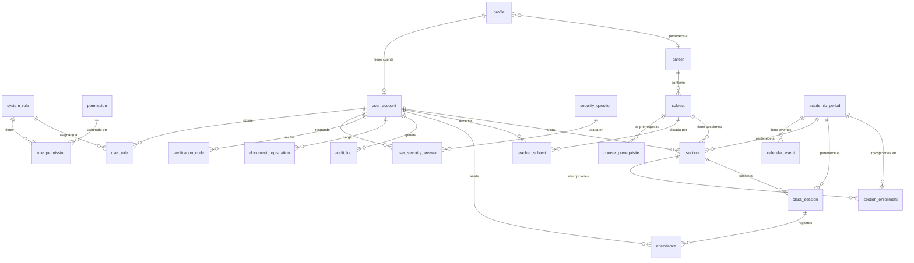
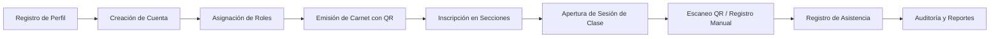

# Documentación de la Base de Datos — UNEFA Asistencias & Carnets

> [!NOTE]
> Esta documentación fue hecha a partir de las 5 migraciones Laravel ubicadas en `database/migrations/`. Fecha: **21 de noviembre de 2026**. Esta no es la versión definitiva y puede ser modificada en un futuro si surgen cambios en la estructura de la base de datos.

---

## Diagrama Entidad-Relación

---

## Arquitectura por Módulos

La base de datos se organiza en **5 módulos funcionales**, cada uno correspondiente a una migración:

| # | Módulo | Tablas | Migración |
|---|--------|--------|-----------|
| 1 | Seguridad y Autenticación | 10 tablas | `000001_create_security_and_auth_tables` |
| 2 | Académico y Pensum | 5 tablas | `000002_create_academic_tables` |
| 3 | Inscripciones y Secciones | 3 tablas | `000003_create_enrollment_and_section_tables` |
| 4 | Asistencias | 2 tablas | `000004_create_attendance_tables` |
| 5 | Auditoría | 2 tablas | `000005_create_audit_tables` |

**Total: 22 tablas**

---

## Módulo 1 — Seguridad y Autenticación

### `system_role`
Catálogo de roles del sistema con nivel jerárquico.

| Columna | Tipo | Restricciones | Descripción |
|---------|------|---------------|-------------|
| `id` | INT UNSIGNED | PK, Auto-increment | Identificador único |
| `role_name` | VARCHAR(50) | UNIQUE | Nombre del rol (ej: Admin, Profesor, Estudiante) |
| `hierarchy_level` | TINYINT UNSIGNED | INDEX | Nivel jerárquico para control de acceso |
| `description` | VARCHAR(255) | NOT NULL | Descripción del rol |

**Índices:** `uniq_role_name` (UNIQUE), `idx_role_hierarchy` (INDEX)

---

### `permission`
Catálogo de permisos agrupados por módulo.

| Columna | Tipo | Restricciones | Descripción |
|---------|------|---------------|-------------|
| `id` | INT UNSIGNED | PK, Auto-increment | Identificador único |
| `permission_key` | VARCHAR(80) | UNIQUE | Clave técnica del permiso (ej: `attendance.create`) |
| `permission_name` | VARCHAR(100) | NOT NULL | Nombre legible del permiso |
| `module` | VARCHAR(50) | INDEX | Módulo al que pertenece |
| `description` | VARCHAR(255) | NULLABLE | Descripción opcional |

**Índices:** `uniq_permission_key` (UNIQUE), `idx_permission_module` (INDEX)

---

### `role_permission`
Tabla pivote que asigna permisos a roles (N:M).

| Columna | Tipo | Restricciones | Descripción |
|---------|------|---------------|-------------|
| `id` | INT UNSIGNED | PK, Auto-increment | Identificador único |
| `role_id` | INT UNSIGNED | FK → `system_role.id` ON DELETE CASCADE | Rol asociado |
| `permission_id` | INT UNSIGNED | FK → `permission.id` ON DELETE CASCADE, INDEX | Permiso asociado |

**Índices:** `uniq_role_permission` (UNIQUE compuesto), `idx_rp_permission` (INDEX)

---

### `profile`
Datos personales del usuario. Separado de las credenciales para permitir que un perfil exista sin cuenta activa.

| Columna | Tipo | Restricciones | Descripción |
|---------|------|---------------|-------------|
| `id` | INT UNSIGNED | PK, Auto-increment | Identificador único |
| `career_id` | INT UNSIGNED | FK → `career.id` ON DELETE SET NULL, NULLABLE, INDEX | Carrera asociada |
| `id_number` | VARCHAR(20) | UNIQUE | Cédula de identidad |
| `id_type` | VARCHAR(2) | DEFAULT 'V' | Tipo de cédula (V = venezolano, E = extranjero) |
| `first_name` | VARCHAR(50) | NOT NULL | Primer nombre |
| `middle_name` | VARCHAR(50) | NULLABLE | Segundo nombre |
| `last_name` | VARCHAR(50) | NOT NULL | Primer apellido |
| `second_last_name` | VARCHAR(50) | NULLABLE | Segundo apellido |
| `current_semester` | TINYINT UNSIGNED | DEFAULT 1 | Semestre actual del estudiante |
| `has_dragged_subjects` | BOOLEAN | DEFAULT false | ¿Tiene materias arrastradas? |
| `address` | VARCHAR(255) | NULLABLE | Dirección de residencia |
| `phone` | VARCHAR(20) | NULLABLE | Teléfono de contacto |
| `job_title` | VARCHAR(100) | NULLABLE | Cargo (para docentes/administrativos) |
| `profile_picture` | VARCHAR(255) | NULLABLE | Ruta de la foto de perfil |
| `created_at` | TIMESTAMP | Auto | Fecha de creación |
| `updated_at` | TIMESTAMP | Auto | Última actualización |

**Índices:** `uniq_id_number` (UNIQUE), `idx_profile_career` (INDEX), `idx_profile_semester` (compuesto: `current_semester`, `has_dragged_subjects`)

---

### `user_account`
Credenciales de acceso al sistema. Relación 1:1 con `profile`.

| Columna | Tipo | Restricciones | Descripción |
|---------|------|---------------|-------------|
| `id` | INT UNSIGNED | PK, Auto-increment | Identificador único |
| `profile_id` | INT UNSIGNED | FK → `profile.id` ON DELETE CASCADE, UNIQUE | Perfil asociado (1:1) |
| `username` | VARCHAR(100) | UNIQUE | Nombre de usuario |
| `email` | VARCHAR(100) | UNIQUE | Correo electrónico |
| `password_hash` | VARCHAR(255) | NOT NULL | Hash de la contraseña |
| `qr_token` | VARCHAR(128) | UNIQUE | Token QR único y permanente por persona |
| `security_pin_hash` | VARCHAR(255) | NULLABLE | Hash del PIN de seguridad |
| `pin_expires_at` | DATETIME | NULLABLE, INDEX | Fecha de expiración del PIN |
| `pin_updated_at` | DATETIME | NULLABLE | Última actualización del PIN |
| `status` | ENUM | DEFAULT 'Pending', INDEX | Estado: `Pending`, `Approved`, `Rejected`, `Inactive` |
| `created_at` | TIMESTAMP | Auto | Fecha de creación |
| `updated_at` | TIMESTAMP | Auto | Última actualización |

**Índices:** `uniq_profile_id`, `uniq_username`, `uniq_email`, `uniq_user_qr_token` (todos UNIQUE), `idx_user_pin_expiration`, `idx_user_status` (INDEX)

> [!IMPORTANT]
> El campo `qr_token` es un identificador **único y permanente** por persona. Se usa para generar el código QR del carnet y registrar asistencias mediante escaneo.

---

### `user_role`
Asignación de múltiples roles por usuario. Cada asignación puede incluir un número de carnet (credencial).

| Columna | Tipo | Restricciones | Descripción |
|---------|------|---------------|-------------|
| `id` | INT UNSIGNED | PK, Auto-increment | Identificador único |
| `user_id` | INT UNSIGNED | FK → `user_account.id` ON DELETE CASCADE | Usuario |
| `role_id` | INT UNSIGNED | FK → `system_role.id` ON DELETE RESTRICT | Rol asignado |
| `is_active` | BOOLEAN | DEFAULT true | ¿Rol activo? |
| `credential_number` | VARCHAR(50) | NULLABLE, UNIQUE | Número de carnet/credencial |
| `credential_issued_at` | DATETIME | NULLABLE | Fecha de emisión del carnet |
| `credential_expires_at` | DATETIME | NULLABLE | Fecha de vencimiento del carnet |
| `assigned_at` | TIMESTAMP | Auto | Fecha de asignación |

**Índices:** `uniq_user_role` (UNIQUE compuesto), `uniq_credential_number` (UNIQUE), `idx_ur_role_active` (compuesto)

> [!TIP]
> Un usuario puede tener múltiples roles simultáneos (ej: Estudiante + Preparador). El borrado de un `system_role` está **restringido** (`RESTRICT`) para evitar eliminar roles que estén en uso.

---

### `security_question`
Catálogo de preguntas de seguridad para recuperación de cuenta.

| Columna | Tipo | Restricciones | Descripción |
|---------|------|---------------|-------------|
| `id` | INT UNSIGNED | PK, Auto-increment | Identificador único |
| `question_text` | VARCHAR(255) | NOT NULL | Texto de la pregunta |

---

### `user_security_answer`
Respuestas del usuario a las preguntas de seguridad (almacenadas como hash).

| Columna | Tipo | Restricciones | Descripción |
|---------|------|---------------|-------------|
| `id` | INT UNSIGNED | PK, Auto-increment | Identificador único |
| `user_id` | INT UNSIGNED | FK → `user_account.id` ON DELETE CASCADE | Usuario |
| `question_id` | INT UNSIGNED | FK → `security_question.id` ON DELETE CASCADE, INDEX | Pregunta |
| `answer_hash` | VARCHAR(255) | NOT NULL | Hash de la respuesta |

**Índices:** `uniq_user_question` (UNIQUE compuesto), `idx_answer_question` (INDEX)

---

### `verification_code`
Códigos de verificación para 2FA y recuperación de contraseña/PIN.

| Columna | Tipo | Restricciones | Descripción |
|---------|------|---------------|-------------|
| `id` | INT UNSIGNED | PK, Auto-increment | Identificador único |
| `user_id` | INT UNSIGNED | FK → `user_account.id` ON DELETE CASCADE | Usuario destinatario |
| `code` | VARCHAR(10) | INDEX | Código de verificación |
| `code_type` | ENUM | DEFAULT 'Password_Reset' | Tipo: `2FA_Login`, `Password_Reset`, `Security_Questions_Reset`, `Pin_Reset` |
| `expires_at` | DATETIME | NOT NULL | Fecha/hora de expiración |
| `is_used` | BOOLEAN | DEFAULT false | ¿Ya fue utilizado? |
| `created_at` | TIMESTAMP | Auto | Fecha de creación |

**Índices:** `idx_vc_code` (INDEX), `idx_vc_lookup` (compuesto: `user_id`, `code_type`, `is_used`, `expires_at`)

---

### `document_registration`
Carga y validación de documentos/expedientes de estudiantes.

| Columna | Tipo | Restricciones | Descripción |
|---------|------|---------------|-------------|
| `id` | INT UNSIGNED | PK, Auto-increment | Identificador único |
| `user_id` | INT UNSIGNED | FK → `user_account.id` ON DELETE CASCADE | Usuario que carga el documento |
| `file_name` | VARCHAR(255) | NOT NULL | Nombre original del archivo |
| `file_path` | VARCHAR(255) | NOT NULL | Ruta de almacenamiento |
| `file_type` | ENUM | DEFAULT 'PDF' | Tipo: `Word`, `PDF`, `Image`, `Excel` |
| `status` | ENUM | DEFAULT 'Pending', INDEX | Estado: `Pending`, `Approved`, `Rejected` |
| `observations` | VARCHAR(500) | NULLABLE | Observaciones del revisor |
| `uploaded_at` | TIMESTAMP | Auto | Fecha de carga |

**Índices:** `idx_doc_status` (INDEX), `idx_doc_user_status` (compuesto)

---

## Módulo 2 — Académico y Pensum

### `career`
Carreras universitarias ofertadas.

| Columna | Tipo | Restricciones | Descripción |
|---------|------|---------------|-------------|
| `id` | INT UNSIGNED | PK, Auto-increment | Identificador único |
| `career_code` | VARCHAR(20) | UNIQUE | Código de la carrera |
| `career_name` | VARCHAR(100) | NOT NULL | Nombre de la carrera |
| `coordinator_id` | INT UNSIGNED | FK → `user_account.id` ON DELETE SET NULL, NULLABLE, INDEX | Coordinador asignado |

**Índices:** `uniq_career_code` (UNIQUE), `idx_career_coordinator` (INDEX)

---

### `subject`
Asignaturas del pensum por carrera y semestre.

| Columna | Tipo | Restricciones | Descripción |
|---------|------|---------------|-------------|
| `id` | INT UNSIGNED | PK, Auto-increment | Identificador único |
| `career_id` | INT UNSIGNED | FK → `career.id` ON DELETE SET NULL, NULLABLE, DEFAULT 1 | Carrera a la que pertenece |
| `subject_code` | VARCHAR(20) | UNIQUE | Código de la asignatura |
| `subject_name` | VARCHAR(100) | NOT NULL | Nombre de la asignatura |
| `semester` | TINYINT UNSIGNED | NULLABLE, INDEX | Semestre en el que se cursa |
| `credit_units` | TINYINT UNSIGNED | DEFAULT 3 | Unidades de crédito |
| `display_order` | TINYINT UNSIGNED | DEFAULT 1 | Orden de visualización |

**Índices:** `uniq_subject_code` (UNIQUE), `idx_subject_semester` (INDEX), `idx_subject_career_semester` (compuesto)

---

### `course_prerequisite`
Prelaciones entre asignaturas (relación reflexiva N:M).

| Columna | Tipo | Restricciones | Descripción |
|---------|------|---------------|-------------|
| `id` | INT UNSIGNED | PK, Auto-increment | Identificador único |
| `subject_id` | INT UNSIGNED | FK → `subject.id` ON DELETE CASCADE | Asignatura que tiene la prelación |
| `prerequisite_id` | INT UNSIGNED | FK → `subject.id` ON DELETE CASCADE, INDEX | Asignatura prerrequisito |

**Índices:** `uniq_subject_prereq` (UNIQUE compuesto), `idx_prereq_required` (INDEX)

---

### `academic_period`
Períodos académicos (semestres/trimestres).

| Columna | Tipo | Restricciones | Descripción |
|---------|------|---------------|-------------|
| `id` | INT UNSIGNED | PK, Auto-increment | Identificador único |
| `period_name` | VARCHAR(50) | UNIQUE | Nombre del período (ej: 2026-I) |
| `start_date` | DATE | NOT NULL | Fecha de inicio |
| `end_date` | DATE | NULLABLE | Fecha de fin |
| `duration_weeks` | TINYINT UNSIGNED | DEFAULT 16 | Duración en semanas |
| `status` | ENUM | DEFAULT 'Active', INDEX | Estado: `Active`, `Closed`, `Planned` |
| `created_at` | TIMESTAMP | Auto | Fecha de creación |

**Índices:** `uniq_period_name` (UNIQUE), `idx_period_status` (INDEX)

---

### `calendar_event`
Eventos del cronograma académico vinculados a un período.

| Columna | Tipo | Restricciones | Descripción |
|---------|------|---------------|-------------|
| `id` | INT UNSIGNED | PK, Auto-increment | Identificador único |
| `period_id` | INT UNSIGNED | FK → `academic_period.id` ON DELETE CASCADE | Período asociado |
| `year` | SMALLINT UNSIGNED | NOT NULL | Año del evento |
| `category` | VARCHAR(50) | NOT NULL | Categoría (ej: Inscripción, Exámenes, Feriado) |
| `description` | VARCHAR(300) | NOT NULL | Descripción del evento |
| `start_date` | DATE | NOT NULL | Fecha de inicio |
| `end_date` | DATE | NOT NULL | Fecha de fin |
| `created_at` | TIMESTAMP | Auto | Fecha de creación |

**Índices:** `idx_event_period_dates` (compuesto: `period_id`, `start_date`, `end_date`)

---

## Módulo 3 — Inscripciones y Secciones

### `teacher_subject`
Relación de docentes habilitados para dictar una asignatura.

| Columna | Tipo | Restricciones | Descripción |
|---------|------|---------------|-------------|
| `id` | INT UNSIGNED | PK, Auto-increment | Identificador único |
| `teacher_id` | INT UNSIGNED | FK → `user_account.id` ON DELETE CASCADE | Docente |
| `subject_id` | INT UNSIGNED | FK → `subject.id` ON DELETE CASCADE, INDEX | Asignatura |
| `assigned_by_id` | INT UNSIGNED | FK → `user_account.id` ON DELETE SET NULL, NULLABLE, INDEX | Quién realizó la asignación |
| `created_at` | TIMESTAMP | Auto | Fecha de asignación |

**Índices:** `uniq_teacher_subject` (UNIQUE compuesto), `idx_ts_subject`, `idx_ts_assigned_by` (INDEX)

---

### `section`
Secciones de clase con horario, aula y tolerancia de asistencia.

| Columna | Tipo | Restricciones | Descripción |
|---------|------|---------------|-------------|
| `id` | INT UNSIGNED | PK, Auto-increment | Identificador único |
| `subject_id` | INT UNSIGNED | FK → `subject.id` ON DELETE CASCADE, INDEX | Asignatura |
| `teacher_id` | INT UNSIGNED | FK → `user_account.id` ON DELETE CASCADE, INDEX | Docente a cargo |
| `period_id` | INT UNSIGNED | FK → `academic_period.id` ON DELETE CASCADE | Período académico |
| `section_name` | VARCHAR(30) | NOT NULL | Nombre de la sección (ej: S1, S2) |
| `day_of_week` | ENUM | DEFAULT 'Monday' | Día: `Monday` a `Sunday` |
| `start_time` | TIME | DEFAULT '08:00:00' | Hora de inicio |
| `end_time` | TIME | DEFAULT '10:00:00' | Hora de fin |
| `tolerance_minutes` | TINYINT UNSIGNED | DEFAULT 15 | Minutos de tolerancia para asistencia |
| `classroom` | VARCHAR(50) | DEFAULT 'Aula 01' | Aula asignada |
| `status` | ENUM | DEFAULT 'Active' | Estado: `Active`, `Inactive` |

**Índices:** `idx_section_subject`, `idx_section_teacher` (INDEX), `idx_section_period_status` (compuesto), `idx_section_schedule` (compuesto: `day_of_week`, `start_time`)

---

### `section_enrollment`
Inscripciones de estudiantes en secciones con notas y control de materias arrastradas.

| Columna | Tipo | Restricciones | Descripción |
|---------|------|---------------|-------------|
| `id` | INT UNSIGNED | PK, Auto-increment | Identificador único |
| `student_id` | INT UNSIGNED | FK → `user_account.id` ON DELETE CASCADE | Estudiante inscrito |
| `section_id` | INT UNSIGNED | FK → `section.id` ON DELETE CASCADE, INDEX | Sección |
| `period_id` | INT UNSIGNED | FK → `academic_period.id` ON DELETE CASCADE, INDEX | Período |
| `status` | ENUM | DEFAULT 'Pending', INDEX | Estado: `Pending`, `Enrolled`, `Approved`, `Failed`, `Withdrawn`, `Rejected` |
| `is_dragged` | BOOLEAN | DEFAULT false | ¿Es materia arrastrada? |
| `final_grade` | TINYINT UNSIGNED | DEFAULT 0 | Nota final (0-20) |
| `validated_by_coordinator` | BOOLEAN | DEFAULT false | ¿Validada por el coordinador? |
| `is_cycle_closed` | BOOLEAN | DEFAULT false | ¿Ciclo de evaluación cerrado? |
| `assigned_at` | TIMESTAMP | Auto | Fecha de inscripción |
| `updated_at` | TIMESTAMP | Auto | Última actualización |

**Índices:** `uniq_student_section` (UNIQUE compuesto), `idx_enrollment_section`, `idx_enrollment_period`, `idx_enrollment_status` (INDEX), `idx_enrollment_dragged` (compuesto: `student_id`, `status`, `is_dragged`)

> [!WARNING]
> El campo `is_dragged` marca materias que el estudiante está repitiendo. Esto se refleja también en `profile.has_dragged_subjects` como una bandera rápida de consulta.

---

## Módulo 4 — Asistencias

### `class_session`
Sesiones de clase (apertura y cierre por sección y semana).

| Columna | Tipo | Restricciones | Descripción |
|---------|------|---------------|-------------|
| `id` | INT UNSIGNED | PK, Auto-increment | Identificador único |
| `section_id` | INT UNSIGNED | FK → `section.id` ON DELETE CASCADE | Sección |
| `period_id` | INT UNSIGNED | FK → `academic_period.id` ON DELETE CASCADE, INDEX | Período |
| `opened_by_id` | INT UNSIGNED | FK → `user_account.id` ON DELETE CASCADE, INDEX | Quién abrió la sesión |
| `session_date` | DATE | INDEX | Fecha de la sesión |
| `start_time` | TIME | NULLABLE | Hora real de inicio |
| `end_time` | TIME | NULLABLE | Hora real de cierre |
| `tolerance_minutes` | TINYINT UNSIGNED | DEFAULT 15 | Tolerancia para esta sesión |
| `session_type` | ENUM | DEFAULT 'Regular' | Tipo: `Regular`, `Extraordinary` |
| `week_number` | TINYINT UNSIGNED | NULLABLE | Número de semana del período |
| `status` | ENUM | DEFAULT 'Open' | Estado: `Open`, `Closed` |
| `observations` | VARCHAR(255) | NULLABLE | Observaciones del docente |
| `created_at` | TIMESTAMP | Auto | Fecha de creación |

**Índices:** `idx_session_period`, `idx_session_opener`, `idx_session_date` (INDEX), `idx_session_section_status` (compuesto: `section_id`, `status`, `session_date`)

---

### `attendance`
Registro de asistencia por estudiante en cada sesión de clase.

| Columna | Tipo | Restricciones | Descripción |
|---------|------|---------------|-------------|
| `id` | INT UNSIGNED | PK, Auto-increment | Identificador único |
| `session_id` | INT UNSIGNED | FK → `class_session.id` ON DELETE CASCADE | Sesión de clase |
| `student_id` | INT UNSIGNED | FK → `user_account.id` ON DELETE CASCADE | Estudiante |
| `registered_by_id` | INT UNSIGNED | FK → `user_account.id` ON DELETE SET NULL, NULLABLE, INDEX | Quién registró la asistencia |
| `attendance_status` | ENUM | DEFAULT 'Present' | Estado: `Present`, `Absent`, `Excused`, `Late` |
| `registration_method` | ENUM | DEFAULT 'QR', INDEX | Método: `QR`, `Manual` |
| `observation` | VARCHAR(255) | NULLABLE | Observaciones |
| `recorded_at` | TIMESTAMP | Auto | Fecha/hora del registro |

**Índices:** `uniq_session_student` (UNIQUE compuesto), `idx_attendance_student_status` (compuesto), `idx_attendance_registrar`, `idx_attendance_method` (INDEX)

> [!IMPORTANT]
> La asistencia se registra principalmente por **escaneo del código QR** del carnet (`registration_method = 'QR'`), usando el `qr_token` de `user_account`. El docente puede también registrar manualmente (`Manual`).

---

## Módulo 5 — Auditoría

### `audit_log`
Bitácora de acciones importantes del sistema para trazabilidad.

| Columna | Tipo | Restricciones | Descripción |
|---------|------|---------------|-------------|
| `id` | INT UNSIGNED | PK, Auto-increment | Identificador único |
| `user_id` | INT UNSIGNED | FK → `user_account.id` ON DELETE SET NULL, NULLABLE | Usuario que realizó la acción |
| `action` | VARCHAR(100) | INDEX | Nombre/tipo de la acción |
| `detail` | VARCHAR(500) | NULLABLE | Detalle descriptivo |
| `ip_address` | VARCHAR(45) | NULLABLE | Dirección IP (soporta IPv6) |
| `created_at` | TIMESTAMP | Auto, INDEX | Fecha/hora del evento |

**Índices:** `idx_audit_action`, `idx_audit_timestamp` (INDEX), `idx_audit_user_date` (compuesto: `user_id`, `created_at`)

---

### `failed_attempt`
Registro de intentos fallidos de acceso para detección de fuerza bruta y bloqueo por IP.

| Columna | Tipo | Restricciones | Descripción |
|---------|------|---------------|-------------|
| `id` | INT UNSIGNED | PK, Auto-increment | Identificador único |
| `ip_address` | VARCHAR(45) | NOT NULL | Dirección IP del intento |
| `attempt_type` | VARCHAR(20) | DEFAULT 'login' | Tipo de intento (ej: login, pin, 2fa) |
| `identifier` | VARCHAR(100) | NULLABLE | Identificador usado (usuario/email) |
| `attempted_at` | TIMESTAMP | Auto | Fecha/hora del intento |

**Índices:** `idx_failed_lookup` (compuesto: `ip_address`, `attempt_type`, `attempted_at`)

---

## Resumen de Relaciones y Claves Foráneas

| FK | Tabla origen | Columna | → Tabla destino | Columna | ON DELETE |
|----|-------------|---------|-----------------|---------|-----------|
| `fk_rp_role` | role_permission | role_id | system_role | id | CASCADE |
| `fk_rp_permission` | role_permission | permission_id | permission | id | CASCADE |
| `fk_profile_career` | profile | career_id | career | id | SET NULL |
| `fk_user_profile` | user_account | profile_id | profile | id | CASCADE |
| `fk_ur_user` | user_role | user_id | user_account | id | CASCADE |
| `fk_ur_role` | user_role | role_id | system_role | id | RESTRICT |
| `fk_answer_user` | user_security_answer | user_id | user_account | id | CASCADE |
| `fk_answer_question` | user_security_answer | question_id | security_question | id | CASCADE |
| `fk_vc_user` | verification_code | user_id | user_account | id | CASCADE |
| `fk_doc_user` | document_registration | user_id | user_account | id | CASCADE |
| `fk_career_coordinator` | career | coordinator_id | user_account | id | SET NULL |
| `fk_subject_career` | subject | career_id | career | id | SET NULL |
| `fk_prereq_subject` | course_prerequisite | subject_id | subject | id | CASCADE |
| `fk_prereq_required` | course_prerequisite | prerequisite_id | subject | id | CASCADE |
| `fk_event_period` | calendar_event | period_id | academic_period | id | CASCADE |
| `fk_ts_teacher` | teacher_subject | teacher_id | user_account | id | CASCADE |
| `fk_ts_subject` | teacher_subject | subject_id | subject | id | CASCADE |
| `fk_ts_assigned_by` | teacher_subject | assigned_by_id | user_account | id | SET NULL |
| `fk_section_subject` | section | subject_id | subject | id | CASCADE |
| `fk_section_teacher` | section | teacher_id | user_account | id | CASCADE |
| `fk_section_period` | section | period_id | academic_period | id | CASCADE |
| `fk_enroll_student` | section_enrollment | student_id | user_account | id | CASCADE |
| `fk_enroll_section` | section_enrollment | section_id | section | id | CASCADE |
| `fk_enroll_period` | section_enrollment | period_id | academic_period | id | CASCADE |
| `fk_session_section` | class_session | section_id | section | id | CASCADE |
| `fk_session_period` | class_session | period_id | academic_period | id | CASCADE |
| `fk_session_opener` | class_session | opened_by_id | user_account | id | CASCADE |
| `fk_attendance_session` | attendance | session_id | class_session | id | CASCADE |
| `fk_attendance_student` | attendance | student_id | user_account | id | CASCADE |
| `fk_attendance_registrar` | attendance | registered_by_id | user_account | id | SET NULL |
| `fk_audit_user` | audit_log | user_id | user_account | id | SET NULL |

---

## Flujo Principal del Sistema

---

## Convenciones de Diseño

| Aspecto | Convención |
|---------|------------|
| **Motor** | Laravel Migrations (Eloquent Schema Builder) |
| **PKs** | `id` INT UNSIGNED Auto-increment en todas las tablas |
| **Naming** | snake_case para tablas y columnas |
| **FKs** | Prefijo `fk_` + abreviatura de tabla + columna |
| **Índices** | Prefijo `idx_` para índices, `uniq_` para únicos |
| **Timestamps** | `created_at` / `updated_at` con `useCurrent()` |
| **Soft Deletes** | No implementados — se usa `status` / `is_active` |
| **IP Storage** | VARCHAR(45) para soportar IPv6 |
| **Hashing** | Contraseñas, PINs y respuestas de seguridad almacenados como hash (VARCHAR 255) |
