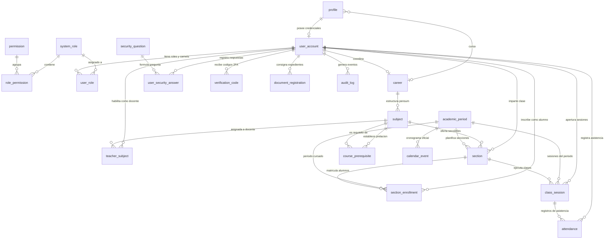
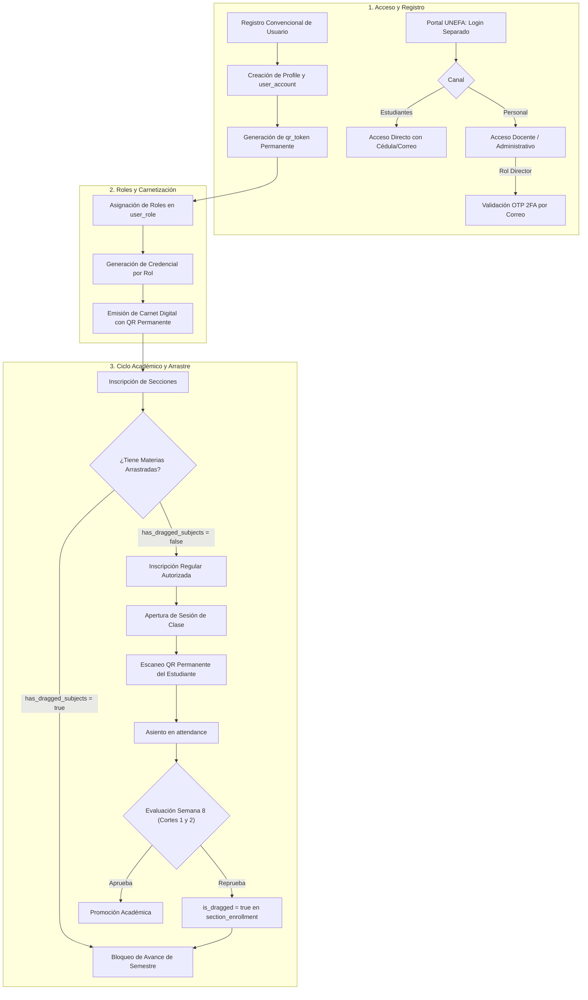

# Documentación Oficial de la Base de Datos
## Sistema Unificado de Control de Asistencias y Carnetización Digital — UNEFA

> [!NOTE]
> **Metadatos del Documento:**
> - **Versión Actual:** `2.1.0` (Consolidada y Verificada).
> - **Rama de Integración:** `develop`.
> - **Motor / Framework:** Laravel 11 (Eloquent Migrations & Schema Builder) / MySQL 8.0+ & MariaDB 10.4+.
> - **Total de Tablas:** 22 tablas normalizadas en Tercera Forma Normal (3FN).

---

## Cronología Oficial de Actualizaciones

A continuación se detalla la línea de tiempo oficial de diseño, ajuste e integración del esquema de base de datos del proyecto:

| Fecha | Versión | Tipo de Cambio | Resumen del Hito |
| :---: | :---: | :--- | :--- |
| **20/11/2026** | `v1.0.0` | **Creación Inicial del Esquema** | Creación y despliegue inicial de las 5 migraciones Laravel (`database/migrations/`), estructuración de las 22 tablas en 3FN, desarrollo del seeder base `UnefaInitialDataSeeder.php` y generación del script DDL [schema.sql](file:///c:/Users/Gagr/Documents/GitHub/UNEFA-Asistencias-Carnets/database/schema.sql). |
| **21/11/2026** | `v2.0.0` | **Directrices Institucionales Mandatorias** | Emisión e incorporación formal de las 5 nuevas directrices operativas: adopción de QR único y permanente por usuario, carnetización independiente para múltiples roles por persona, bloqueo curricular por materias arrastradas, migración de nomenclatura "SICEU" a "Portal" con login dual y registro convencional, y fijación del hito evaluativo en Semana 8. |
| **22/11/2026** | `v2.1.0` | **Integración y Consolidación en `develop`** | Fusión integral en la rama `develop` de Laravel 11, migraciones, seeders, vistas Blade y aplicación móvil Expo. Actualización bidireccional entre la base de datos y la Especificación de Requerimientos, resolución de inconsistencias de índices y adición de recomendaciones para observadores de eventos. |

---

## Apartado Especial: Registro de Cambios de la Última Versión (`v2.1.0` — 22/11/2026)

Este apartado resume todos los cambios arquitecturales, estructurales y funcionales incorporados en la versión actual del sistema respecto a los borradores preliminares:

### 1. Cambios en Modelado y Atributos de Tablas
- **`user_account.qr_token` (QR Permanente de por vida):**
  - Se confirmó el uso exclusivo de `qr_token` (`VARCHAR(128) UNIQUE`) generado una sola vez al dar de alta la cuenta universitaria.
  - **Eliminación:** Se erradicó formalmente la necesidad de tablas intermedias o temporales de códigos QR (anteriormente planteadas como `two_factor_code` para asistencias o tablas de tokens rotativos).
- **`user_role` (Múltiples Carnets y Roles Concurrentes):**
  - Se habilitó a nivel relacional que una persona física posea simultáneamente múltiples registros activos (ej. Estudiante y Docente/Preparador).
  - Cada fila en `user_role` resguarda su propio número de carnet (`credential_number VARCHAR(50) UNIQUE`), fecha de expedición (`credential_issued_at`) y fecha de vencimiento (`credential_expires_at`), lo que permite imprimir y gestionar carnets independientes por rol con vigencias y plantillas diferenciadas.
- **`profile.has_dragged_subjects` y `section_enrollment.is_dragged` (Semáforo de Arrastre):**
  - Implementación del índice compuesto `idx_profile_semester` (`current_semester`, `has_dragged_subjects`) en `profile` para consultas instantáneas durante la inscripción.
  - Implementación del índice compuesto `idx_enrollment_dragged` (`student_id`, `status`, `is_dragged`) en `section_enrollment` para trazabilidad de asignaturas en repitencia.
  - Regla de negocio activa: Mientras `has_dragged_subjects = true` o existan asignaturas con `status = 'Failed'`, el sistema bloquea el incremento formal de semestre (`current_semester + 1`) y la matriculación en materias avanzadas.

### 2. Cambios en Nomenclatura, Interfaz y Flujos de Acceso
- **Sustitución de "SICEU" por "Portal":**
  - Se homologó toda la base de datos, rutas, vistas Blade y controladores eliminando cualquier referencia residual a "SICEU", reemplazándola por **"Portal Institucional / Portal Académico UNEFA"**.
- **Separación de Interfaces de Autenticación (Login Bifurcado):**
  - **Canal Estudiantes:** Acceso directo con Cédula/Correo y Contraseña.
  - **Canal Personal (Docentes y Directores):** Acceso con políticas de seguridad extendidas. Para el rol Director, se conecta con la tabla `verification_code` (código OTP de 6 dígitos enviado por correo) y se valida la clave secundaria almacenada en `user_account.security_pin_hash`.
- **Registro Directo de Cuenta Convencional:**
  - El flujo de registro estudiantil ya no opera bajo el esquema antiguo de preinscripción CINU, sino como una apertura de cuenta formal universitaria que asienta el perfil en `profile`, la cuenta en `user_account` en estado `Pending` y habilita la subida de documentos a `document_registration`.

### 3. Sincronización con el Cronograma Académico (Semana 8)
- **Hito Evaluativo Sumativo (1er y 2do Corte):**
  - En virtud de la confirmación docente de evaluar el 1er y 2do corte juntos en la **Semana 8**, se ajustaron las validaciones de las tablas `academic_period` (duración estándar de 16 semanas), `calendar_event` (eventos de corte de notas) y `class_session` (`week_number`), garantizando el registro ordenado de las sesiones que preceden a dicha evaluación.

---

## Matriz de Trazabilidad: Directrices vs Base de Datos

| Directriz Mandatoria | Tablas Involucradas | Columnas Clave | Índices / Restricciones | Comportamiento en Base de Datos |
| :--- | :--- | :--- | :--- | :--- |
| **QR Único y Permanente** | `user_account` | `qr_token` (VARCHAR 128) | `uniq_user_qr_token` (UNIQUE) | Identificador estático generado al registrar la cuenta. Usado en carnet físico/digital y lector QR de asistencia. Sin tablas efímeras. |
| **Múltiples Roles y Carnets** | `user_role`, `system_role`, `role_permission` | `credential_number`, `credential_issued_at`, `credential_expires_at`, `is_active` | `uniq_credential_number` (UNIQUE), `uniq_user_role` (UNIQUE compuesto) | Permite asignar varios roles a un usuario. Cada asignación genera una credencial física/digital con serial y vigencia propia. |
| **Control de Materias Arrastradas** | `profile`, `section_enrollment`, `course_prerequisite`, `subject` | `profile.has_dragged_subjects`, `profile.current_semester`, `section_enrollment.is_dragged`, `section_enrollment.status` | `idx_profile_semester`, `idx_enrollment_dragged` | Si el alumno reprueba (`Failed`) o arrastra (`is_dragged`), el sistema bloquea su avance curricular al semestre superior hasta aprobarla. |
| **Ajustes de Interfaz y Acceso** | `user_account`, `verification_code`, `document_registration` | `code_type`, `security_pin_hash`, `pin_expires_at`, `document_registration.status` | `idx_vc_lookup`, `idx_doc_user_status` | Soporta canal Estudiante vs Personal, envío de 2FA por correo para directores y recepción de recaudos digitales. |
| **Hito Evaluativo Semana 8** | `academic_period`, `calendar_event`, `class_session`, `section_enrollment` | `academic_period.duration_weeks`, `class_session.week_number`, `section_enrollment.final_grade` | `idx_event_period_dates`, `idx_session_section_status` | Estructura el ciclo lectivo en 16 semanas y permite el registro de clases semanales para el corte evaluativo unificado en semana 8. |

---

## Diagrama Entidad-Relación Global



---

## Arquitectura por Módulos (22 Tablas)

El modelo de datos se organiza en **5 módulos funcionales**, correspondientes a las 5 migraciones Laravel del proyecto:

| # | Módulo Funcional | Tablas | Archivo de Migración Laravel |
|---|---|:---:|---|
| 1 | Seguridad, Roles y Autenticación | 10 | `2026_11_20_000001_create_security_and_auth_tables.php` |
| 2 | Académico, Pensum y Calendario | 5 | `2026_11_20_000002_create_academic_tables.php` |
| 3 | Secciones, Docentes e Inscripciones | 3 | `2026_11_20_000003_create_enrollment_and_section_tables.php` |
| 4 | Sesiones y Control de Asistencias | 2 | `2026_11_20_000004_create_attendance_tables.php` |
| 5 | Auditoría y Seguridad Perimetral | 2 | `2026_11_20_000005_create_audit_tables.php` |

---

## Módulo 1 — Seguridad, Roles y Autenticación

### `system_role`
Catálogo de roles institucionales con nivel jerárquico numérico para control de acceso RBAC.

| Columna | Tipo de Dato | Restricciones | Descripción |
|---|---|---|---|
| `id` | INT UNSIGNED | PK, Auto-increment | Identificador único del rol |
| `role_name` | VARCHAR(50) | UNIQUE | Nombre formal del rol (`Super Administrator`, `Director`, `Academic Coordinator`, `Teacher`, `Student`) |
| `hierarchy_level` | TINYINT UNSIGNED | INDEX | Nivel de precedencia jerárquica (1 = Máximo privilegio) |
| `description` | VARCHAR(255) | NOT NULL | Resumen del alcance y funciones asignadas al rol |

- **Índices:** `uniq_role_name` (UNIQUE), `idx_role_hierarchy` (INDEX).
- **Guía de Funcionamiento:** Define la estructura de permisos jerárquicos. El borrado de roles está protegido mediante integridad referencial restrictiva en `user_role`.

---

### `permission`
Catálogo de permisos atómicos agrupados por módulo funcional.

| Columna | Tipo de Dato | Restricciones | Descripción |
|---|---|---|---|
| `id` | INT UNSIGNED | PK, Auto-increment | Identificador único del permiso |
| `permission_key` | VARCHAR(80) | UNIQUE | Clave técnica en formato `modulo.accion` (ej: `attendance.scan`, `credential.issue`) |
| `permission_name` | VARCHAR(100) | NOT NULL | Nombre legible del permiso |
| `module` | VARCHAR(50) | INDEX | Dominio al que pertenece (`Seguridad`, `Direccion`, `Coordinacion`, `Docencia`, `General`, `Estudiantes`) |
| `description` | VARCHAR(255) | NULLABLE | Detalle explicativo de la operación autorizada |

- **Índices:** `uniq_permission_key` (UNIQUE), `idx_permission_module` (INDEX).

---

### `role_permission`
Tabla intermedia (N:M) que asocia privilegios atómicos a los roles del sistema.

| Columna | Tipo de Dato | Restricciones | Descripción |
|---|---|---|---|
| `id` | INT UNSIGNED | PK, Auto-increment | Identificador único de la asignación |
| `role_id` | INT UNSIGNED | FK → `system_role.id` ON DELETE CASCADE | Rol beneficiario |
| `permission_id` | INT UNSIGNED | FK → `permission.id` ON DELETE CASCADE, INDEX | Permiso otorgado |

- **Índices:** `uniq_role_permission` (UNIQUE compuesto `[role_id, permission_id]`), `idx_rp_permission` (INDEX).

---

### `profile`
Entidad que resguarda los datos personales y civiles del individuo. Se mantiene desacoplada de `user_account` para permitir que existan perfiles académicos pre-cargados antes de formalizar la activación de usuario.

| Columna | Tipo de Dato | Restricciones | Descripción |
|---|---|---|---|
| `id` | INT UNSIGNED | PK, Auto-increment | Identificador único del perfil |
| `career_id` | INT UNSIGNED | FK → `career.id` ON DELETE SET NULL, NULLABLE, INDEX | Carrera o programa al que está adscrito |
| `id_number` | VARCHAR(20) | UNIQUE | Número de Cédula de Identidad |
| `id_type` | VARCHAR(2) | DEFAULT 'V' | Tipo de documento (`V` = Venezolano, `E` = Extranjero) |
| `first_name` | VARCHAR(50) | NOT NULL | Primer nombre |
| `middle_name` | VARCHAR(50) | NULLABLE | Segundo nombre |
| `last_name` | VARCHAR(50) | NOT NULL | Primer apellido |
| `second_last_name` | VARCHAR(50) | NULLABLE | Segundo apellido |
| `current_semester` | TINYINT UNSIGNED | DEFAULT 1 | Semestre en curso del estudiante |
| `has_dragged_subjects` | BOOLEAN | DEFAULT false | Bandera rápida de materias reprobadas o arrastradas |
| `address` | VARCHAR(255) | NULLABLE | Dirección física de residencia |
| `phone` | VARCHAR(20) | NULLABLE | Número telefónico de contacto |
| `job_title` | VARCHAR(100) | NULLABLE | Cargo laboral (para personal docente y administrativo) |
| `profile_picture` | VARCHAR(255) | NULLABLE | Nombre de archivo o ruta de la fotografía institucional |
| `created_at` | TIMESTAMP | DEFAULT CURRENT_TIMESTAMP | Fecha de alta del perfil |
| `updated_at` | TIMESTAMP | DEFAULT CURRENT_TIMESTAMP ON UPDATE CURRENT_TIMESTAMP | Fecha de última modificación |

- **Índices:** `uniq_id_number` (UNIQUE), `idx_profile_career` (INDEX), `idx_profile_semester` (INDEX compuesto `[current_semester, has_dragged_subjects]`).

**Guía de Lógica de Negocio — Control de Avance de Semestre:**  
El campo `current_semester` registra el nivel académico nominal del estudiante. Cuando la bandera `has_dragged_subjects` se encuentra en `true`, las reglas de control de estudios estipulan la inhabilitación inmediata del avance al semestre inmediato superior (`current_semester + 1`), restringiendo la inscripción de nuevas asignaturas avanzadas hasta que las materias adeudadas sean aprobadas. El índice compuesto `idx_profile_semester (current_semester, has_dragged_subjects)` optimiza las consultas de validación en tiempo real en los procesos de inscripción. *(Para consultar los riesgos de desincronización de este campo, véase la falla FD-01 en el apartado final de fallas del diseño).*

---

### `user_account`
Credenciales y parámetros de autenticación del usuario. Relación unívoca (1:1) estricta con `profile`.

| Columna | Tipo de Dato | Restricciones | Descripción |
|---|---|---|---|
| `id` | INT UNSIGNED | PK, Auto-increment | Identificador único de la cuenta |
| `profile_id` | INT UNSIGNED | FK → `profile.id` ON DELETE CASCADE, UNIQUE | Vínculo directo 1:1 con los datos personales |
| `username` | VARCHAR(100) | UNIQUE | Identificador alfanumérico para inicio de sesión |
| `email` | VARCHAR(100) | UNIQUE | Correo institucional o personal verificado |
| `password_hash` | VARCHAR(255) | NOT NULL | Hash seguro de la contraseña principal (Bcrypt / Argon2) |
| `qr_token` | VARCHAR(128) | UNIQUE | Identificador alfanumérico permanente y único por persona |
| `security_pin_hash` | VARCHAR(255) | NULLABLE | Hash del PIN secundario de autorización (Director) |
| `pin_expires_at` | DATETIME | NULLABLE, INDEX | Fecha de caducidad del PIN de autorización |
| `pin_updated_at` | DATETIME | NULLABLE | Marca temporal del último cambio de PIN |
| `status` | ENUM | DEFAULT 'Pending', INDEX | Estado operativo: `Pending`, `Approved`, `Rejected`, `Inactive` |
| `created_at` | TIMESTAMP | DEFAULT CURRENT_TIMESTAMP | Fecha de creación de la cuenta |
| `updated_at` | TIMESTAMP | DEFAULT CURRENT_TIMESTAMP ON UPDATE CURRENT_TIMESTAMP | Fecha de última actualización |

- **Índices:** `uniq_profile_id` (UNIQUE), `uniq_username` (UNIQUE), `uniq_email` (UNIQUE), `uniq_user_qr_token` (UNIQUE), `idx_user_pin_expiration` (INDEX), `idx_user_status` (INDEX).

**Guía de Lógica de Negocio — Token QR Permanente e Inmutable:**  
El identificador `qr_token` se genera de forma única al momento de crear la cuenta universitaria y permanece inalterable a lo largo de toda la permanencia del usuario en la institución. Opera como el código unívoco embebido en el carnet físico y digital, y actúa como credencial fija para el pase de lista diario en el aula. Su persistencia descarta el uso de tablas separadas para códigos temporales o esquemas de regeneración efímera.

---

### `user_role`
Asignación de roles al usuario. Permite **polimorfismo de roles y emisión de credenciales independientes**.

| Columna | Tipo de Dato | Restricciones | Descripción |
|---|---|---|---|
| `id` | INT UNSIGNED | PK, Auto-increment | Identificador único del registro de rol |
| `user_id` | INT UNSIGNED | FK → `user_account.id` ON DELETE CASCADE | Cuenta de usuario beneficiaria |
| `role_id` | INT UNSIGNED | FK → `system_role.id` ON DELETE RESTRICT | Rol otorgado |
| `is_active` | BOOLEAN | DEFAULT true | Estado de habilitación del rol |
| `credential_number` | VARCHAR(50) | NULLABLE, UNIQUE | Folio / Serial del carnet correspondiente a este rol |
| `credential_issued_at` | DATETIME | NULLABLE | Fecha de emisión de la credencial para este rol |
| `credential_expires_at` | DATETIME | NULLABLE | Fecha de expiración de la credencial para este rol |
| `assigned_at` | TIMESTAMP | DEFAULT CURRENT_TIMESTAMP | Fecha de asignación del rol |

- **Índices:** `uniq_user_role` (UNIQUE compuesto `[user_id, role_id]`), `uniq_credential_number` (UNIQUE), `idx_ur_role_active` (INDEX compuesto `[role_id, is_active]`).

**Guía de Lógica de Negocio — Emisión de Múltiples Roles y Carnets Independientes:**  
La arquitectura admite que una misma persona cuente con múltiples roles activos de manera simultánea (por ejemplo, Estudiante de pregrado y Docente titular o Preparador). Cada asignación formal en `user_role` genera un folio de credencial independiente (`credential_number`), con fecha de emisión y fecha de caducidad propia. Esto habilita la expedición y portabilidad de credenciales diferenciadas según el rol institucional ejercido, manteniendo los permisos segregados según la sesión seleccionada por el usuario. La eliminación física de roles en `system_role` está restringida (`RESTRICT`) para preservar la integridad histórica de los carnets emitidos.

---

### `security_question`
Catálogo institucional de preguntas predefinidas para la recuperación de accesos.

| Columna | Tipo de Dato | Restricciones | Descripción |
|---|---|---|---|
| `id` | INT UNSIGNED | PK, Auto-increment | Identificador único de la pregunta |
| `question_text` | VARCHAR(255) | NOT NULL | Enunciado de la interrogante de seguridad |

---

### `user_security_answer`
Respuestas almacenadas de forma unidireccional (hash) provistas por el usuario.

| Columna | Tipo de Dato | Restricciones | Descripción |
|---|---|---|---|
| `id` | INT UNSIGNED | PK, Auto-increment | Identificador único del registro |
| `user_id` | INT UNSIGNED | FK → `user_account.id` ON DELETE CASCADE | Usuario titular |
| `question_id` | INT UNSIGNED | FK → `security_question.id` ON DELETE CASCADE, INDEX | Pregunta contestada |
| `answer_hash` | VARCHAR(255) | NOT NULL | Hash Bcrypt de la respuesta normalizada (validada entre 4 y 16 caracteres) |

- **Índices:** `uniq_user_question` (UNIQUE compuesto `[user_id, question_id]`), `idx_answer_question` (INDEX).

---

### `verification_code`
Mecanismo centralizado para despacho de códigos de un solo uso (OTP) por correo electrónico (2FA de Directores, reseteo de claves y validación de PIN).

| Columna | Tipo de Dato | Restricciones | Descripción |
|---|---|---|---|
| `id` | INT UNSIGNED | PK, Auto-increment | Identificador único del código OTP |
| `user_id` | INT UNSIGNED | FK → `user_account.id` ON DELETE CASCADE | Destinatario del código |
| `code` | VARCHAR(10) | INDEX | Código aleatorio generado (numérico de 6 dígitos) |
| `code_type` | ENUM | DEFAULT 'Password_Reset' | Propósito: `2FA_Login`, `Password_Reset`, `Security_Questions_Reset`, `Pin_Reset` |
| `expires_at` | DATETIME | NOT NULL | Marca límite de vigencia del código (típicamente 10 minutos) |
| `is_used` | BOOLEAN | DEFAULT false | Bandera de consumo del código |
| `created_at` | TIMESTAMP | DEFAULT CURRENT_TIMESTAMP | Fecha y hora de generación |

- **Índices:** `idx_vc_code` (INDEX), `idx_vc_lookup` (INDEX compuesto `[user_id, code_type, is_used, expires_at]`).

---

### `document_registration`
Repositorio documental de expedientes digitales presentados por estudiantes y aspirantes durante el proceso de matriculación.

| Columna | Tipo de Dato | Restricciones | Descripción |
|---|---|---|---|
| `id` | INT UNSIGNED | PK, Auto-increment | Identificador único del recaudo |
| `user_id` | INT UNSIGNED | FK → `user_account.id` ON DELETE CASCADE | Usuario que consigna el documento |
| `file_name` | VARCHAR(255) | NOT NULL | Nombre físico o denominación del archivo |
| `file_path` | VARCHAR(255) | NOT NULL | Ruta interna en el sistema de almacenamiento (`storage/app/`) |
| `file_type` | ENUM | DEFAULT 'PDF' | Formato de archivo: `Word`, `PDF`, `Image`, `Excel` |
| `status` | ENUM | DEFAULT 'Pending', INDEX | Estado de revisión: `Pending`, `Approved`, `Rejected` |
| `observations` | VARCHAR(500) | NULLABLE | Motivos de rechazo o notas aclaratorias de Control de Estudios |
| `uploaded_at` | TIMESTAMP | DEFAULT CURRENT_TIMESTAMP | Fecha de carga del expediente |

- **Índices:** `idx_doc_status` (INDEX), `idx_doc_user_status` (INDEX compuesto `[user_id, status]`).

---

## Módulo 2 — Académico, Pensum y Calendario

### `career`
Programas de formación académica ofertados en la sede o núcleo universitario.

| Columna | Tipo de Dato | Restricciones | Descripción |
|---|---|---|---|
| `id` | INT UNSIGNED | PK, Auto-increment | Identificador único de la carrera |
| `career_code` | VARCHAR(20) | UNIQUE | Código de carrera oficial (ej: `SYS-ING`) |
| `career_name` | VARCHAR(100) | NOT NULL | Nombre oficial (ej: `Ingeniería de Sistemas`) |
| `coordinator_id` | INT UNSIGNED | FK → `user_account.id` ON DELETE SET NULL, NULLABLE, INDEX | Usuario con rol de Coordinador asignado a la dirección del pensum |

- **Índices:** `uniq_career_code` (UNIQUE), `idx_career_coordinator` (INDEX).

---

### `subject`
Malla curricular de asignaturas distribuidas por semestre y carrera.

| Columna | Tipo de Dato | Restricciones | Descripción |
|---|---|---|---|
| `id` | INT UNSIGNED | PK, Auto-increment | Identificador único de la materia |
| `career_id` | INT UNSIGNED | FK → `career.id` ON DELETE SET NULL, NULLABLE, DEFAULT 1 | Carrera a la que corresponde la asignatura |
| `subject_code` | VARCHAR(20) | UNIQUE | Código de cátedra unificado |
| `subject_name` | VARCHAR(100) | NOT NULL | Nombre de la asignatura |
| `semester` | TINYINT UNSIGNED | NULLABLE, INDEX | Semestre académico de ubicación natural (1 al 10) |
| `credit_units` | TINYINT UNSIGNED | DEFAULT 3 | Carga valorativa en unidades de crédito |
| `display_order` | TINYINT UNSIGNED | DEFAULT 1 | Orden secuencial de renderizado en el pensum |

- **Índices:** `uniq_subject_code` (UNIQUE), `idx_subject_semester` (INDEX), `idx_subject_career_semester` (INDEX compuesto `[career_id, semester]`).

---

### `course_prerequisite`
Matriz relacional recursiva (N:M) de prelaciones y requisitos académicos entre asignaturas.

| Columna | Tipo de Dato | Restricciones | Descripción |
|---|---|---|---|
| `id` | INT UNSIGNED | PK, Auto-increment | Identificador único de la prelación |
| `subject_id` | INT UNSIGNED | FK → `subject.id` ON DELETE CASCADE | Materia dependiente que exige el requisito |
| `prerequisite_id` | INT UNSIGNED | FK → `subject.id` ON DELETE CASCADE, INDEX | Materia prerrequisito indispensable |

- **Índices:** `uniq_subject_prereq` (UNIQUE compuesto `[subject_id, prerequisite_id]`), `idx_prereq_required` (INDEX).

---

### `academic_period`
Ciclos y términos lectivos de la institución (semestres regulares o intensivos).

| Columna | Tipo de Dato | Restricciones | Descripción |
|---|---|---|---|
| `id` | INT UNSIGNED | PK, Auto-increment | Identificador único del período |
| `period_name` | VARCHAR(50) | UNIQUE | Nombre formal del período (ej: `2026-1`) |
| `start_date` | DATE | NOT NULL | Fecha oficial de inicio de actividades |
| `end_date` | DATE | NULLABLE | Fecha proyectada o real de cierre del ciclo |
| `duration_weeks` | TINYINT UNSIGNED | DEFAULT 16 | Extensión estándar en semanas lectivas |
| `status` | ENUM | DEFAULT 'Active', INDEX | Estado del período: `Active`, `Closed`, `Planned` |
| `created_at` | TIMESTAMP | DEFAULT CURRENT_TIMESTAMP | Fecha de alta del período |

- **Índices:** `uniq_period_name` (UNIQUE), `idx_period_status` (INDEX).

---

### `calendar_event`
Cronograma detallado de hitos, jornadas y evaluaciones programadas por período académico.

| Columna | Tipo de Dato | Restricciones | Descripción |
|---|---|---|---|
| `id` | INT UNSIGNED | PK, Auto-increment | Identificador único del evento |
| `period_id` | INT UNSIGNED | FK → `academic_period.id` ON DELETE CASCADE | Período al que se circunscribe |
| `year` | SMALLINT UNSIGNED | NOT NULL | Año del evento |
| `category` | VARCHAR(50) | NOT NULL | Tipo de hito (ej: `Inscripción`, `Evaluación`, `Feriado`, `Corte de Notas`) |
| `description` | VARCHAR(300) | NOT NULL | Detalle del hito (ej: `Evaluación Sumativa 1er y 2do Corte`) |
| `start_date` | DATE | NOT NULL | Fecha de inicio |
| `end_date` | DATE | NOT NULL | Fecha de finalización |
| `created_at` | TIMESTAMP | DEFAULT CURRENT_TIMESTAMP | Fecha de registro en el cronograma |

- **Índices:** `idx_event_period_dates` (INDEX compuesto `[period_id, start_date, end_date]`).

---

## Módulo 3 — Secciones, Docentes e Inscripciones

### `teacher_subject`
Habilitación y asignación de docentes titulares por cátedra.

| Columna | Tipo de Dato | Restricciones | Descripción |
|---|---|---|---|
| `id` | INT UNSIGNED | PK, Auto-increment | Identificador único de la habilitación |
| `teacher_id` | INT UNSIGNED | FK → `user_account.id` ON DELETE CASCADE | Usuario con rol Docente habilitado |
| `subject_id` | INT UNSIGNED | FK → `subject.id` ON DELETE CASCADE, INDEX | Asignatura autorizada |
| `assigned_by_id` | INT UNSIGNED | FK → `user_account.id` ON DELETE SET NULL, NULLABLE, INDEX | Coordinador o Director que autorizó la asignación |
| `created_at` | TIMESTAMP | DEFAULT CURRENT_TIMESTAMP | Fecha de asignación de carga |

- **Índices:** `uniq_teacher_subject` (UNIQUE compuesto `[teacher_id, subject_id]`), `idx_ts_subject` (INDEX), `idx_ts_assigned_by` (INDEX).

---

### `section`
Grupos y secciones operativas de clase con asignación de horario, aula y margen de tolerancia.

| Columna | Tipo de Dato | Restricciones | Descripción |
|---|---|---|---|
| `id` | INT UNSIGNED | PK, Auto-increment | Identificador único de la sección |
| `subject_id` | INT UNSIGNED | FK → `subject.id` ON DELETE CASCADE, INDEX | Asignatura dictada |
| `teacher_id` | INT UNSIGNED | FK → `user_account.id` ON DELETE CASCADE, INDEX | Docente responsable |
| `period_id` | INT UNSIGNED | FK → `academic_period.id` ON DELETE CASCADE | Período académico en curso |
| `section_name` | VARCHAR(30) | NOT NULL | Denominación de la sección (ej: `01-D`, `02-N`) |
| `day_of_week` | ENUM | DEFAULT 'Monday' | Día de clase: `Monday`, `Tuesday`, `Wednesday`, `Thursday`, `Friday`, `Saturday`, `Sunday` |
| `start_time` | TIME | DEFAULT '08:00:00' | Hora de inicio estipulada |
| `end_time` | TIME | DEFAULT '10:00:00' | Hora de culminación estipulada |
| `tolerance_minutes` | TINYINT UNSIGNED | DEFAULT 15 | Margen en minutos para registrar asistencia sin retardo |
| `classroom` | VARCHAR(50) | DEFAULT 'Aula 01' | Identificador del espacio físico o laboratorio |
| `status` | ENUM | DEFAULT 'Active' | Estado operativo: `Active`, `Inactive` |

- **Índices:** `idx_section_subject` (INDEX), `idx_section_teacher` (INDEX), `idx_section_period_status` (INDEX compuesto `[period_id, status]`), `idx_section_schedule` (INDEX compuesto `[day_of_week, start_time]`).

---

### `section_enrollment`
Matrícula e inscripción individual de estudiantes en secciones con registro de calificaciones y control estricto de materias arrastradas.

| Columna | Tipo de Dato | Restricciones | Descripción |
|---|---|---|---|
| `id` | INT UNSIGNED | PK, Auto-increment | Identificador único de la inscripción |
| `student_id` | INT UNSIGNED | FK → `user_account.id` ON DELETE CASCADE | Estudiante matriculado |
| `section_id` | INT UNSIGNED | FK → `section.id` ON DELETE CASCADE, INDEX | Sección inscrita |
| `period_id` | INT UNSIGNED | FK → `academic_period.id` ON DELETE CASCADE, INDEX | Período académico en curso |
| `status` | ENUM | DEFAULT 'Pending', INDEX | Condición académica: `Pending`, `Enrolled`, `Approved`, `Failed`, `Withdrawn`, `Rejected` |
| `is_dragged` | BOOLEAN | DEFAULT false | Bandera de materia cursada en condición de arrastre/repitencia |
| `final_grade` | TINYINT UNSIGNED | DEFAULT 0 | Calificación definitiva obtenida en escala 0-20 |
| `validated_by_coordinator` | BOOLEAN | DEFAULT false | Certificación de validez emitida por Control de Estudios |
| `is_cycle_closed` | BOOLEAN | DEFAULT false | Cierre de actas y consolidación de notas definitivas |
| `assigned_at` | TIMESTAMP | DEFAULT CURRENT_TIMESTAMP | Fecha de matriculación |
| `updated_at` | TIMESTAMP | DEFAULT CURRENT_TIMESTAMP ON UPDATE CURRENT_TIMESTAMP | Fecha de modificación o asentamiento de nota |

- **Índices:** `uniq_student_section` (UNIQUE compuesto `[student_id, section_id]`), `idx_enrollment_section` (INDEX), `idx_enrollment_period` (INDEX), `idx_enrollment_status` (INDEX), `idx_enrollment_dragged` (INDEX compuesto `[student_id, status, is_dragged]`).

**Guía de Lógica de Negocio — Ciclo de Vida de Inscripciones y Repitencia:**  
El ciclo de vida de una inscripción transita formalmente por las etapas: `Pending` (solicitud inicial de matriculación por el estudiante) → `Enrolled` (validada y ratificada por Control de Estudios) → `Approved` o `Failed` (asentamiento definitivo al cierre del ciclo evaluativo). Los estados `Withdrawn` (retiro formal reglamentario de la asignatura) y `Rejected` (rechazo por falta de cupo o incumplimiento de prelaciones) constituyen salidas anticipadas del ciclo regular. La calificación se asienta en escala vigesimal (0-20) en `final_grade`. Si una materia culmina con nota reprobatoria (`Failed`), dicha asignatura adquiere automáticamente la condición de arrastre (`is_dragged = true`), lo cual debe reflejarse en el perfil del alumno impidiendo la inscripción de materias superiores hasta su aprobación.

---

## Módulo 4 — Sesiones y Control de Asistencias

### `class_session`
Apertura, control y cierre formal de cada jornada o bloque de clase presencial.

| Columna | Tipo de Dato | Restricciones | Descripción |
|---|---|---|---|
| `id` | INT UNSIGNED | PK, Auto-increment | Identificador único de la sesión |
| `section_id` | INT UNSIGNED | FK → `section.id` ON DELETE CASCADE | Sección asociada |
| `period_id` | INT UNSIGNED | FK → `academic_period.id` ON DELETE CASCADE, INDEX | Período académico activo |
| `opened_by_id` | INT UNSIGNED | FK → `user_account.id` ON DELETE CASCADE, INDEX | Docente que formaliza la apertura de la sesión |
| `session_date` | DATE | INDEX | Fecha calendario en que se imparte |
| `start_time` | TIME | NULLABLE | Hora exacta de inicio registrada por el docente |
| `end_time` | TIME | NULLABLE | Hora de culminación y cierre de la toma de lista |
| `tolerance_minutes` | TINYINT UNSIGNED | DEFAULT 15 | Tolerancia de puntualidad aplicada en minutos |
| `session_type` | ENUM | DEFAULT 'Regular' | Naturaleza de la clase: `Regular`, `Extraordinary` |
| `week_number` | TINYINT UNSIGNED | NULLABLE | Número de semana lectiva (1 a 16) |
| `status` | ENUM | DEFAULT 'Open' | Estado de la sesión: `Open`, `Closed` |
| `observations` | VARCHAR(255) | NULLABLE | Notas pedagógicas u ocurrencias registradas por el profesor |
| `created_at` | TIMESTAMP | DEFAULT CURRENT_TIMESTAMP | Marca de tiempo de apertura |

- **Índices:** `idx_session_period` (INDEX), `idx_session_opener` (INDEX), `idx_session_date` (INDEX), `idx_session_section_status` (INDEX compuesto `[section_id, status, session_date]`).

---

### `attendance`
Registro individualizado del pase de lista por estudiante en cada sesión de clase.

| Columna | Tipo de Dato | Restricciones | Descripción |
|---|---|---|---|
| `id` | INT UNSIGNED | PK, Auto-increment | Identificador único del registro de asistencia |
| `session_id` | INT UNSIGNED | FK → `class_session.id` ON DELETE CASCADE | Sesión de clase a la que asiste |
| `student_id` | INT UNSIGNED | FK → `user_account.id` ON DELETE CASCADE | Estudiante registrado |
| `registered_by_id` | INT UNSIGNED | FK → `user_account.id` ON DELETE SET NULL, NULLABLE, INDEX | Docente o usuario que formaliza la captura |
| `attendance_status` | ENUM | DEFAULT 'Present' | Estado de presencia: `Present`, `Absent`, `Excused`, `Late` |
| `registration_method` | ENUM | DEFAULT 'QR', INDEX | Vía de captura: `QR` (escaneo directo de carnet), `Manual` |
| `observation` | VARCHAR(255) | NULLABLE | Justificación médica o nota aclaratoria del retardo |
| `recorded_at` | TIMESTAMP | DEFAULT CURRENT_TIMESTAMP | Marca de tiempo exacta del escaneo o marcado |

- **Índices:** `uniq_session_student` (UNIQUE compuesto `[session_id, student_id]`), `idx_attendance_student_status` (INDEX compuesto `[student_id, attendance_status]`), `idx_attendance_registrar` (INDEX), `idx_attendance_method` (INDEX).

**Guía de Lógica de Negocio — Pase de Lista y No Duplicidad:**  
El registro de asistencia se efectúa prioritariamente mediante el escaneo del código QR del carnet estudiantil (`registration_method = 'QR'`), validando el `qr_token` contra la cuenta de usuario. La restricción de clave única compuesta `uniq_session_student (session_id, student_id)` asegura a nivel relacional que ningún estudiante pueda tener más de un registro de asistencia en la misma sesión de clase. Ante contingencias técnicas o ausencia temporal del dispositivo lector, el docente cuenta con la facultad reglamentaria de asentar la asistencia manualmente (`registration_method = 'Manual'`) registrando observaciones explicativas.

---

## Módulo 5 — Auditoría y Seguridad Perimetral

### `audit_log`
Bitácora forense de operaciones y eventos sensibles del sistema institucional.

| Columna | Tipo de Dato | Restricciones | Descripción |
|---|---|---|---|
| `id` | INT UNSIGNED | PK, Auto-increment | Identificador único del registro de bitácora |
| `user_id` | INT UNSIGNED | FK → `user_account.id` ON DELETE SET NULL, NULLABLE | Usuario que ejecutó la operación (NULL si es anónimo/sistema) |
| `action` | VARCHAR(100) | INDEX | Denominación técnica de la acción (ej: `login`, `qr_scan`, `grade_update`) |
| `detail` | VARCHAR(500) | NULLABLE | Resumen descriptivo de la transacción y parámetros |
| `ip_address` | VARCHAR(45) | NULLABLE | Dirección IP origen (compatible con IPv4 e IPv6) |
| `created_at` | TIMESTAMP | DEFAULT CURRENT_TIMESTAMP, INDEX | Fecha y hora exacta del suceso |

- **Índices:** `idx_audit_action` (INDEX), `idx_audit_timestamp` (INDEX), `idx_audit_user_date` (INDEX compuesto `[user_id, created_at]`).

---

### `failed_attempt`
Monitoreo y mitigación perimetral contra ataques de fuerza bruta y denegación de servicio.

| Columna | Tipo de Dato | Restricciones | Descripción |
|---|---|---|---|
| `id` | INT UNSIGNED | PK, Auto-increment | Identificador único del intento fallido |
| `ip_address` | VARCHAR(45) | NOT NULL | Dirección IP origen del intento |
| `attempt_type` | VARCHAR(20) | DEFAULT 'login' | Canal vulnerado: `login`, `pin`, `2fa` |
| `identifier` | VARCHAR(100) | NULLABLE | Cédula, usuario o correo intentado |
| `attempted_at` | TIMESTAMP | DEFAULT CURRENT_TIMESTAMP | Marca temporal del intento |

- **Índices:** `idx_failed_lookup` (INDEX compuesto `[ip_address, attempt_type, attempted_at]`).

---

## Relaciones de Integridad Referencial (Claves Foráneas)

El esquema implementa un total de **28 claves foráneas** con reglas de eliminación estrictas:

| Identificador FK | Tabla Origen | Columna Local | Tabla Destino | Columna Destino | Política ON DELETE |
| :--- | :--- | :--- | :--- | :--- | :--- |
| `fk_rp_role` | `role_permission` | `role_id` | `system_role` | `id` | `CASCADE` |
| `fk_rp_permission` | `role_permission` | `permission_id` | `permission` | `id` | `CASCADE` |
| `fk_profile_career` | `profile` | `career_id` | `career` | `id` | `SET NULL` |
| `fk_user_profile` | `user_account` | `profile_id` | `profile` | `id` | `CASCADE` |
| `fk_ur_user` | `user_role` | `user_id` | `user_account` | `id` | `CASCADE` |
| `fk_ur_role` | `user_role` | `role_id` | `system_role` | `id` | `RESTRICT` |
| `fk_answer_user` | `user_security_answer` | `user_id` | `user_account` | `id` | `CASCADE` |
| `fk_answer_question` | `user_security_answer` | `question_id` | `security_question` | `id` | `CASCADE` |
| `fk_vc_user` | `verification_code` | `user_id` | `user_account` | `id` | `CASCADE` |
| `fk_doc_user` | `document_registration` | `user_id` | `user_account` | `id` | `CASCADE` |
| `fk_career_coordinator`| `career` | `coordinator_id` | `user_account` | `id` | `SET NULL` |
| `fk_subject_career` | `subject` | `career_id` | `career` | `id` | `SET NULL` |
| `fk_prereq_subject` | `course_prerequisite` | `subject_id` | `subject` | `id` | `CASCADE` |
| `fk_prereq_required` | `course_prerequisite` | `prerequisite_id` | `subject` | `id` | `CASCADE` |
| `fk_event_period` | `calendar_event` | `period_id` | `academic_period` | `id` | `CASCADE` |
| `fk_ts_teacher` | `teacher_subject` | `teacher_id` | `user_account` | `id` | `CASCADE` |
| `fk_ts_subject` | `teacher_subject` | `subject_id` | `subject` | `id` | `CASCADE` |
| `fk_ts_assigned_by` | `teacher_subject` | `assigned_by_id` | `user_account` | `id` | `SET NULL` |
| `fk_section_subject` | `section` | `subject_id` | `subject` | `id` | `CASCADE` |
| `fk_section_teacher` | `section` | `teacher_id` | `user_account` | `id` | `CASCADE` |
| `fk_section_period` | `section` | `period_id` | `academic_period` | `id` | `CASCADE` |
| `fk_enroll_student` | `section_enrollment` | `student_id` | `user_account` | `id` | `CASCADE` |
| `fk_enroll_section` | `section_enrollment` | `section_id` | `section` | `id` | `CASCADE` |
| `fk_enroll_period` | `section_enrollment` | `period_id` | `academic_period` | `id` | `CASCADE` |
| `fk_session_section` | `class_session` | `section_id` | `section` | `id` | `CASCADE` |
| `fk_session_period` | `class_session` | `period_id` | `academic_period` | `id` | `CASCADE` |
| `fk_session_opener` | `class_session` | `opened_by_id` | `user_account` | `id` | `CASCADE` |
| `fk_attendance_session`| `attendance` | `session_id` | `class_session` | `id` | `CASCADE` |
| `fk_attendance_student`| `attendance` | `student_id` | `user_account` | `id` | `CASCADE` |
| `fk_attendance_registrar`| `attendance` | `registered_by_id`| `user_account` | `id` | `SET NULL` |
| `fk_audit_user` | `audit_log` | `user_id` | `user_account` | `id` | `SET NULL` |

---

## Flujo Operativo Integral



---

## Datos Semilla Iniciales (`UnefaInitialDataSeeder`)

Los datos iniciales del sistema se administran mediante seeders de Laravel ubicados en `database/seeders/`. Se ejecutan automáticamente al correr `php artisan db:seed` o `php artisan migrate --seed`:

| Archivo | Propósito Técnico |
|---|---|
| `DatabaseSeeder.php` | Seeder principal de Laravel. Orquesta la ejecución de los seeders del dominio utilizando el trait `WithoutModelEvents` para evitar efectos colaterales durante la carga. |
| `UnefaInitialDataSeeder.php` | Seeder de catálogos y datos base institucionales. Implementa `insertOrIgnore` para garantizar **idempotencia total** (seguro de re-ejecutar sin duplicar registros). |

### Detalle de Datos Sembrados

#### 1. Roles del Sistema (`system_role`) — 5 Registros
| ID | Nombre del Rol | Jerarquía | Descripción Operativa |
|:---:|---|:---:|---|
| **1** | Super Administrator | 1 | Soporte Técnico Central / TI — Acceso exclusivo a Auditoría, Bitácora y Configuración Global |
| **2** | Director | 2 | Rector / Administrador de la Institución — Asigna Coordinadores de Carrera y valida con clave secundaria |
| **3** | Academic Coordinator | 3 | Control de Estudios — Valida Expedientes, Registra Horarios y Emite Carnets Digitales |
| **4** | Teacher | 4 | Docente / Titular de Materia — Gestiona Sesiones de Clase y Asistencias mediante Escaneo QR |
| **5** | Student | 5 | Alumno Regular Aprobado — Acceso a Carnet Digital, QR y Horario Académico |

#### 2. Permisos Atómicos (`permission`) — 11 Registros
| ID | Clave Técnica | Nombre Legible | Módulo |
|:---:|---|---|---|
| **1** | `audit.view` | Ver Bitácora y Auditoría | Seguridad |
| **2** | `system.backup` | Gestionar Respaldos | Seguridad |
| **3** | `coordinator.assign` | Asignar Coordinadores | Dirección |
| **4** | `metrics.global` | Ver Métricas Globales | Dirección |
| **5** | `student.validate_docs` | Validar Expedientes | Coordinación |
| **6** | `credential.issue` | Emitir Carnets | Coordinación |
| **7** | `schedule.manage` | Gestionar Horarios y Secciones | Coordinación |
| **8** | `session.manage` | Abrir y Cerrar Clases | Docencia |
| **9** | `attendance.scan` | Escanear QR y Registrar Asistencia | Docencia |
| **10** | `credential.view_own` | Ver Carnets Propios y QR | General |
| **11** | `schedule.view_own` | Ver Horario y Materias | Estudiantes |

#### 3. Matriz de Permisos por Rol (`role_permission`) — 24 Asignaciones
| Permiso Atómico | Super Admin | Director | Coordinador | Docente | Estudiante |
|---|:---:|:---:|:---:|:---:|:---:|
| `audit.view` | ✅ | | | | |
| `system.backup` | ✅ | | | | |
| `coordinator.assign` | ✅ | ✅ | | | |
| `metrics.global` | ✅ | ✅ | ✅ | | |
| `student.validate_docs` | ✅ | | ✅ | | |
| `credential.issue` | ✅ | | ✅ | | |
| `schedule.manage` | ✅ | | ✅ | | |
| `session.manage` | ✅ | | | ✅ | |
| `attendance.scan` | ✅ | | | ✅ | |
| `credential.view_own` | ✅ | ✅ | ✅ | ✅ | ✅ |
| `schedule.view_own` | ✅ | | | | ✅ |

#### 4. Preguntas de Seguridad Iniciales (`security_question`) — 5 Registros
1. *¿Cuál es el nombre de tu primera mascota?*
2. *¿Cuál es tu ciudad de nacimiento?*
3. *¿Cuál es el segundo nombre de tu madre?*
4. *¿Cuál fue tu primer colegio o escuela?*
5. *¿Cuál es tu comida favorita?*

#### 5. Entidades Base Iniciales
- **Carrera Inicial (`career`):** ID 1, Código `SYS-ING`, Nombre *Ingeniería de Sistemas*.
- **Período Lectivo (`academic_period`):** ID 1, Denominación `2026-1` (Inicio: `2026-02-01`, Fin proyectado: `2026-06-30`, Duración: 16 semanas, Estado: `Active`).
- **Super Administrador de Arranque:**
  - Perfil: Cédula `V-00000000`, Nombre: *Administrador Principal Sistemas UNEFA*.
  - Cuenta: Usuario `admin`, Correo `admin@unefa.edu.ve`, Hash de clave inicial para `admin123`.
  - Token QR Único: `UNEFA-QR-V00000000` (permanente).
  - Carnet Asignado: `CARNET-ADMIN-0001` con vigencia activa de 1 año.

---

## Convenciones de Diseño y Buenas Prácticas

| Aspecto de Diseño | Convención Técnica Adoptada |
|---|---|
| **Motor DDL** | Laravel Migrations (Schema Builder fluído de Eloquent) |
| **Claves Primarias** | `id INT UNSIGNED AUTO_INCREMENT` estandarizado en las 22 tablas |
| **Nomenclatura** | snake_case estricto en minúsculas para tablas y columnas en inglés técnico |
| **Claves Foráneas** | Prefijo `fk_` + abreviatura de tabla origen + columna destino |
| **Índices** | Prefijo `idx_` para índices de búsqueda simple y compuesta; `uniq_` para restricciones únicas |
| **Marcas Temporales** | `created_at` y `updated_at` con `useCurrent()` y actualización automática |
| **Borrado Lógico** | No se usan Soft Deletes nativos; el ciclo de vida se controla mediante campos `status` o `is_active` |
| **Direcciones IP** | `VARCHAR(45)` en `audit_log` y `failed_attempt` para compatibilidad completa con IPv4 e IPv6 |
| **Criptografía** | Bcrypt / Argon2 (VARCHAR 255) para contraseñas, PINs y respuestas de seguridad |
| **Idempotencia** | Seeders con cláusulas `insertOrIgnore` para permitir ejecuciones repetidas seguras |

---

## Fallas, Limitaciones y Riesgos del Diseño de Base de Datos

En esta sección se documentan de manera formal las debilidades estructurales, riesgos de integridad y limitaciones identificadas en el diseño actual del esquema, con el fin de guiar futuras optimizaciones y alertar a los desarrolladores del backend sobre los puntos donde la base de datos no puede garantizar la coherencia por sí sola:

### FD-01: Desnormalización e Inconsistencia entre `section_enrollment.is_dragged` y `profile.has_dragged_subjects`
- **Diagnóstico:** El campo `is_dragged` en `section_enrollment` marca a nivel de detalle qué materia específica está repitiendo un alumno. A su vez, `has_dragged_subjects` en `profile` replica esta información a modo de resumen booleano para acelerar consultas. Esta es una desnormalización deliberada de rendimiento.
- **Falla Estructural:** Al no existir triggers nativos en la base de datos, no hay sincronización automática. Si un estudiante aprueba una materia en `section_enrollment` o retira una inscripción, la bandera `has_dragged_subjects` en `profile` no se actualiza de forma automática, pudiendo dejar al estudiante con un bloqueo indebido de semestre.
- **Riesgo:** Inconsistencia de datos entre el expediente histórico del alumno y su estado de matriculación actual.
- **Mitigación Requerida:** Implementar un **Observer en Laravel** (`SectionEnrollmentObserver`) en los eventos `saved`, `updated` y `deleted` que recalcule `has_dragged_subjects` consultando si quedan inscripciones activas con `is_dragged = true` o `status = 'Failed'`.

### FD-02: Delegación del Bloqueo de Avance Curricular Exclusivamente a la Capa de Aplicación
- **Diagnóstico:** La regla que prohíbe inscribir materias de semestres superiores (`subject.semester > profile.current_semester`) cuando existen materias arrastradas no está forzada a través de restricciones relacionales o de tabla (`CHECK` o triggers `BEFORE INSERT`) en `section_enrollment`.
- **Falla Estructural:** La base de datos aceptará cualquier inserción directa de matrícula si las claves foráneas existen, incluso si el estudiante adeuda materias de primer semestre e inscribe materias de décimo semestre.
- **Riesgo:** Vulnerabilidad ante importaciones masivas por lotes, scripts CLI, migraciones o peticiones concurrentes que omitan las validaciones del controlador, corrompiendo la coherencia académica de las cohortes.
- **Mitigación Requerida:** Incorporar validaciones atómicas en los Form Requests del backend y evaluar la creación de un trigger `BEFORE INSERT ON section_enrollment` que compruebe la matriz `course_prerequisite` y el estado `has_dragged_subjects`.

### FD-03: Ausencia de Restricción Relacional para Solapamiento de Horarios y Aulas en `section`
- **Diagnóstico:** La tabla `section` cuenta con `day_of_week`, `start_time`, `end_time` y `classroom`, acompañados del índice compuesto `idx_section_schedule`.
- **Falla Estructural:** El motor relacional no impide mediante una clave única que dos secciones distintas reserven la misma aula en el mismo bloque horario, ni que un mismo docente (`teacher_id`) sea asignado a dos materias en el mismo rango de tiempo.
- **Riesgo:** Colisión de aulas físicas y sobreasignación horaria de docentes si la validación falla en la interfaz de usuario.
- **Mitigación Requerida:** El módulo de coordinación de horarios debe realizar comprobaciones de no solapamiento mediante bloqueos transaccionales antes de insertar o modificar registros en `section`.

### FD-04: Desacoplamiento entre la Tolerancia de Sesión y la Inserción en `attendance`
- **Diagnóstico:** La tabla `class_session` define `tolerance_minutes`, `start_time`, `end_time` y `status = 'Open'/'Closed'`.
- **Falla Estructural:** La tabla `attendance` no posee una restricción relacional que impida insertar un registro con `attendance_status = 'Present'` cuando la hora de la transacción supere el tiempo de tolerancia o cuando la sesión se encuentre formalmente cerrada (`status = 'Closed'`).
- **Riesgo:** Inserción de asistencias tardías o extemporáneas provocadas por desfase de reloj, peticiones en cola de la app móvil o llamadas directas al endpoint sin validación previa del estado de la sesión.
- **Mitigación Requerida:** Los controladores de asistencia deben ejecutar una transacción atómica verificando que la sesión esté abierta y calculando el delta de minutos para asignar `Late` o rechazar la solicitud si la sesión ya expiró.

### FD-05: Dependencia de Estados Lógicos (`status` / `is_active`) sin Soft Deletes Relacionales
- **Diagnóstico:** El esquema no implementa la columna `deleted_at` para borrado suave (SoftDeletes de Laravel), recurriendo a banderas `status = 'Inactive'` o `is_active = false`.
- **Falla Estructural:** Todas las consultas SQL manuales, reportes y vistas Eloquent están obligadas a incluir explícitamente filtros de estado activo. Si un desarrollador omite `WHERE is_active = true`, registros deshabilitados o docentes inactivos pueden figurar en listas operativas.
- **Riesgo:** Fuga de registros inactivos en actas oficiales, carnets o selectores de inscripción.
- **Mitigación Requerida:** Definir Scopes Globales en los modelos Eloquent de Laravel (`UserRole`, `Section`, `AcademicPeriod`) que filtren por defecto únicamente los registros activos.

---

## Instrucciones de Despliegue y Aprovisionamiento

Para inicializar la base de datos de manera automatizada mediante Laravel:

```bash
# Ejecutar todas las migraciones en orden correlativo
php artisan migrate

# Ejecutar migraciones e insertar catálogos y datos iniciales
php artisan migrate --seed

# Reconstruir la base de datos desde cero (recomendado en desarrollo)
php artisan migrate:fresh --seed
```

Alternativamente, para entornos de producción o servidores sin CLI de PHP disponible, el archivo [database/schema.sql](file:///c:/Users/Gagr/Documents/GitHub/UNEFA-Asistencias-Carnets/database/schema.sql) contiene el volcado DDL y DML estándar compatible con MySQL 8.0+ y MariaDB 10.4+.
